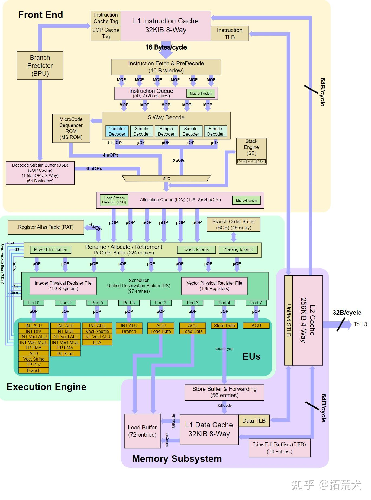

# Intel PCM (Performance Counter Monitor) 全面学习手册

> **目标：** 学习完成后能够熟练使用 PCM 对 CPU、Memory、PCIe 各维度进行无死角性能问题定位。
>
> **适用平台：** Intel Xeon Scalable (Skylake-SP 至 Granite Rapids) 及 Intel Core 系列处理器

---

## 目录

- [第一部分：体系结构基础](#第一部分体系结构基础)
  - [第1章 CPU 微架构深度解析](#第1章-cpu-微架构深度解析)
    - [1.10 流水线各级详解](#110-流水线各级详解)
    - [1.11 IPC 最大值分析](#111-ipc-最大值分析)
    - [1.12 退休宽度、流水线深度与执行端口的区别](#112-退休宽度流水线深度与执行端口的区别)
    - [1.13 超线程 (Hyper-Threading) 微架构资源划分](#113-超线程-hyper-threading-微架构资源划分)
    - [1.14 流水线组件功能详解(对照微架构框图)](#114-流水线组件功能详解对照微架构框图)
  - [第2章 内存子系统架构](#第2章-内存子系统架构)
  - [第3章 PCIe 体系结构](#第3章-pcie-体系结构)
  - [第4章 IOMMU (Intel VT-d)](#第4章-iommu-intel-vt-d)
- [第二部分：Intel PMU 硬件基础](#第二部分intel-pmu-硬件基础)
  - [第5章 性能监控单元 (PMU) 架构](#第5章-性能监控单元-pmu-架构)
  - [第6章 Top-Down 微架构分析方法 (TMAM)](#第6章-top-down-微架构分析方法-tmam)
- [第三部分：PCM 工具全面指南](#第三部分pcm-工具全面指南)
  - [第7章 PCM 概述与安装](#第7章-pcm-概述与安装)
  - [第8章 pcm — 核心监控主工具](#第8章-pcm--核心监控主工具)
  - [第9章 pcm-memory — 内存带宽监控](#第9章-pcm-memory--内存带宽监控)
  - [第10章 pcm-pcie / pcm-iio — PCIe 带宽监控](#第10章-pcm-pcie--pcm-iio--pcie-带宽监控)
  - [第11章 pcm-numa — NUMA 访问分析](#第11章-pcm-numa--numa-访问分析)
  - [第12章 pcm-latency — 内存延迟监控](#第12章-pcm-latency--内存延迟监控)
  - [第13章 pcm-power — 功耗与能效监控](#第13章-pcm-power--功耗与能效监控)
  - [第14章 pcm-core / pcm-raw — 自定义事件监控](#第14章-pcm-core--pcm-raw--自定义事件监控)
  - [第15章 pcm-tsx — 事务内存监控](#第15章-pcm-tsx--事务内存监控)
  - [第16章 pcm-accel — 硬件加速器监控](#第16章-pcm-accel--硬件加速器监控)
  - [第17章 pcm-sensor-server — Grafana 可视化集成](#第17章-pcm-sensor-server--grafana-可视化集成)
  - [第18章 底层工具：pcm-msr / pcm-pcicfg / pcm-mmio / pcm-tpmi](#第18章-底层工具pcm-msr--pcm-pcicfg--pcm-mmio--pcm-tpmi)
- [第四部分：实战性能问题定位](#第四部分实战性能问题定位)
  - [第19章 CPU 性能问题定位实战](#第19章-cpu-性能问题定位实战)
  - [第20章 内存性能问题定位实战](#第20章-内存性能问题定位实战)
  - [第21章 PCIe/IO 性能问题定位实战](#第21章-pcieio-性能问题定位实战)
  - [第22章 综合性能分析工作流](#第22章-综合性能分析工作流)
- [附录](#附录)
  - [附录A：各代 Xeon 微架构参数速查表](#附录a各代-xeon-微架构参数速查表)
  - [附录B：关键性能事件编码速查](#附录b关键性能事件编码速查)
  - [附录C：PCM 环境变量参考](#附录c-pcm-环境变量参考)
  - [附录D：常见问题排查 (FAQ)](#附录d常见问题排查-faq)

---

# 第一部分：体系结构基础

> 要有效使用 PCM 进行性能分析，必须深入理解底层硬件架构。本部分覆盖 CPU 微架构、内存子系统、PCIe 和 IOMMU 的核心概念。

---

## 第1章 CPU 微架构深度解析

### 1.1 流水线总览

Intel 现代 x86 核心采用**深度流水线、超标量、乱序执行**设计。流水线逻辑上分为**前端 (Front-End)** 和**后端 (Back-End)** 两大部分：

```
┌─────────────────────────────────────────────────────────────────────┐
│                        FRONT-END (顺序)                             │
│  ┌──────────┐  ┌──────────┐  ┌──────────┐  ┌──────────┐           │
│  │ 指令获取  │→│ 预解码    │→│ 指令队列  │→│ 解码器    │           │
│  │ (IFU)    │  │(Pre-Dec) │  │  (IQ)    │  │(Decoders)│           │
│  └──────────┘  └──────────┘  └──────────┘  └────┬─────┘           │
│                                                  │                 │
│  ┌──────────────────────┐    ┌───────────────────┴───────┐        │
│  │ 微码序列器 (MSROM)    │    │ uop 缓存 (DSB)            │        │
│  │ 处理复杂指令          │    │ 已解码指令缓存,绕过解码    │        │
│  └──────────┬───────────┘    └───────────┬───────────────┘        │
│             └────────────┬───────────────┘                        │
│                          ▼                                        │
│                ┌──────────────────┐                                │
│                │ 指令解码队列 (IDQ)│                                │
│                └────────┬─────────┘                                │
├─────────────────────────┼─────────────────────────────────────────┤
│                         ▼                                         │
│                   BACK-END (乱序)                                  │
│  ┌──────────────────────────────────────────────────┐             │
│  │            分配/重命名 (Allocate/Rename)          │             │
│  │  分配 ROB 表项, 架构寄存器 → 物理寄存器映射        │             │
│  └────────────────────┬─────────────────────────────┘             │
│                       ▼                                           │
│  ┌──────────────────────────────────────────────────┐             │
│  │            保留站/调度器 (Reservation Station)     │             │
│  │  等待操作数就绪, 分发到执行端口                    │             │
│  └────────────────────┬─────────────────────────────┘             │
│                       ▼                                           │
│  ┌──────────────────────────────────────────────────┐             │
│  │ 执行单元 (Execution Units) — Port 0~7/9          │             │
│  │ ALU | FMA | Load AGU | Store AGU | Branch | ...  │             │
│  └────────────────────┬─────────────────────────────┘             │
│                       ▼                                           │
│  ┌──────────────────────────────────────────────────┐             │
│  │         写回 & 退休 (Writeback & Retire)          │             │
│  │  结果写入物理寄存器文件, 按序从 ROB 退休           │             │
│  └──────────────────────────────────────────────────┘             │
└─────────────────────────────────────────────────────────────────────┘
```

### 1.2 前端 (Front-End) 详解

#### 1.2.1 指令获取 (Instruction Fetch)

- 每周期从 L1i 缓存获取 **16 字节**的指令流
- x86 指令变长 (1~15 字节)，需要预解码确定指令边界
- 获取单元由分支预测器引导，预测下一个获取地址

#### 1.2.2 解码器 (Decoders)

x86 CISC 指令在执行前被解码为内部 **微操作 (uops)**：

| 代次 | 解码宽度 | 说明 |
|------|-----------|------|
| Skylake | 4 (1 复杂 + 3 简单) | 简单解码器：1 uop/指令；复杂解码器：≤4 uops/指令；MITE 峰值 4 uops/周期 |
| Ice Lake (Sunny Cove) | 4 (1 复杂 + 3 简单) | **解码宽度未变**；加宽到 5-wide 的是重命名/分配/退休级 (常见误传点，见 §1.14.5 审计注 1) |
| Sapphire Rapids (Golden Cove) | 6 (含 1 个复杂解码器) | 解码宽度 +50% vs SKL，重命名/分配同为 6-wide |

- 超过 4 uops 的复杂指令 (如 REP MOVS, CPUID) 由**微码序列器 (MSROM)** 处理
- **解码瓶颈**是前端受限的常见原因之一

#### 1.2.3 uop 缓存 / 已解码流缓冲区 (DSB)

DSB 是已解码 uop 的缓存，**完全绕过解码流水线**，是首选解码路径：

| 参数 | Skylake | Ice Lake | Sapphire Rapids |
|------|---------|----------|-----------------|
| 容量 | 1536 uops | 2304 uops | 4096 uops |
| 组织 | 32组 × 8路 × 6 uops/路 | 48组 × 8路 × 6 uops/路 | 64组 × 8路 × 8 uops/路 |
| 吞吐量 | 6 uops/周期 | 6 uops/周期 | 6 uops/周期 |

**关键特性：**
- 以指令指针 (线性地址) 索引
- 每路覆盖一个 **32 字节对齐**的代码区域
- 若 32 字节区域包含的指令解码后超过一路的容量，则无法缓存到 DSB
- DSB 吞吐 (6 uops/周期) 不低于传统解码 (Skylake/Sunny Cove 4 uops/周期、Golden Cove 6 uops/周期)，且命中时省去取指与解码两级流水

**性能监控事件：**
```
IDQ.DSB_UOPS              — 从 DSB 送出的 uops 数
IDQ.MITE_UOPS             — 从传统解码 (MITE) 送出的 uops 数
IDQ.MS_UOPS               — 从微码序列器送出的 uops 数
DSB2MITE_SWITCHES.PENALTY_CYCLES — DSB/MITE 切换惩罚周期
```

**优化目标：** 最大化 DSB 命中率。DSB 未命中会回退到传统解码，降低吞吐量。

### 1.3 后端 (Back-End) 详解

#### 1.3.1 重排序缓冲区 (ROB)

ROB 按程序顺序跟踪所有在飞 uops，实现推测执行和顺序退休：

| 代次 | ROB 条目数 | 影响 |
|------|-----------|------|
| Skylake | 224 | 基准 |
| Ice Lake | 352 (+57%) | 更好的延迟隐藏 |
| Sapphire Rapids | 512 (+129%) | 可容忍更多缓存未命中 |
| Granite Rapids | 512+ | 持续改进 |

- ROB 大小决定了处理器能"往前看"多远来寻找独立工作
- 更大的 ROB = 更好的指令级并行 (ILP) 和缓存未命中隐藏

#### 1.3.2 保留站 / 调度器 (Reservation Station)

保留站保存已重命名但正在等待操作数就绪的 uops：

| 代次 | 条目数 |
|------|--------|
| Skylake | 97 |
| Ice Lake | 160 |
| Sapphire Rapids | 224 |

- 操作数就绪后，uop 被分发到对应的执行端口
- 调度器满时，分配阶段停顿

#### 1.3.3 执行端口 (Execution Ports)

**Skylake (8 端口)：**

| 端口 | 功能单元 | 说明 |
|------|---------|------|
| Port 0 | ALU, Vec ALU, Vec FMA, DIV, AES, Branch | 整数/向量计算, 除法, 分支执行 |
| Port 1 | ALU, Vec ALU, Vec FMA, Vec Multiply, Bit Scan | 整数/向量计算, 乘法 |
| Port 2 | Load AGU | 加载地址生成 |
| Port 3 | Load AGU | 加载地址生成 |
| Port 4 | Store Data | 存储数据 |
| Port 5 | ALU, Vec ALU, Vec Shuffle, LEA | 整数/向量, 洗牌, LEA |
| Port 6 | ALU, Branch, Shift | 整数, 分支, 移位 |
| Port 7 | Store AGU | 存储地址生成 |

- 每周期最多：**2 loads + 1 store**
- 分支执行端口为 Port 0 / Port 6 (Port 5 不执行分支，常见二手表格此处有误，见 §1.14.5 审计注 4)

**Ice Lake+ (10 端口)：**

新增 Port 8 (Store Data) 和 Port 9 (Store AGU)：
- 每周期最多：**2 loads + 2 stores** — 内存密集型负载关键改进

#### 1.3.4 物理寄存器文件 (PRF)

| 代次 | 整数 PRF | 浮点/向量 PRF |
|------|---------|--------------|
| Skylake | 180 条目 | 168 条目 (256-bit) |
| Ice Lake | 280 条目 | 224 条目 (512-bit) |
| Sapphire Rapids | 332+ 条目 | 332+ 条目 (512-bit) |

**寄存器重命名优化：**
- **MOV 消除：** `MOV reg, reg` 在重命名阶段处理，不消耗执行端口
- **零化习语：** `XOR reg, reg` / `SUB reg, reg` 在重命名阶段处理

#### 1.3.5 流水线宽度汇总

| 参数 | Skylake | Ice Lake | Sapphire Rapids |
|------|---------|----------|-----------------|
| 分配宽度 | 4 uops/周期 | 5 uops/周期 | 6 uops/周期 |
| 退休宽度 | 4 uops/周期 | 5 uops/周期 | 6 uops/周期 |

### 1.4 分支预测

#### 1.4.1 分支预测器组件

| 组件 | 功能 | 说明 |
|------|------|------|
| **BTB** (Branch Target Buffer) | 预测分支目标地址 | SKL: ~4K-8K 条目; ICL+: ~5K-12K 条目 |
| **PHT** (Pattern History Table) | 预测 taken/not-taken | TAGE-like 预测器 (SKL+) |
| **RSB** (Return Stack Buffer) | 预测 CALL/RET 的返回地址 | 16-32 条目深度 |
| **间接分支预测器** | 预测间接跳转目标 | 虚函数调用, switch 语句等 |
| **循环检测器** | 检测固定迭代次数的循环 | 预测退出迭代 |

#### 1.4.2 误预测代价

- 误预测惩罚：**~14-17 个周期** (DSB 路径 ~14, 传统解码路径 ~16-17)
- 流水线刷新并从正确目标重新开始

#### 1.4.3 监控事件

```
BR_INST_RETIRED.ALL_BRANCHES      — 所有退休分支指令
BR_MISP_RETIRED.ALL_BRANCHES      — 误预测的退休分支
BACLEARS.ANY                      — 前端重新引导 (BPU 修正)
```

**误预测率 = `BR_MISP_RETIRED.ALL_BRANCHES / BR_INST_RETIRED.ALL_BRANCHES`**

### 1.5 缓存层次结构

#### 1.5.1 L1 指令缓存 (L1i)

| 参数 | 所有代次 |
|------|---------|
| 大小 | 32 KB |
| 关联度 | 8 路 |
| 行大小 | 64 字节 |
| 延迟 | ~4 周期 |

#### 1.5.2 L1 数据缓存 (L1d)

| 参数 | Skylake | Ice Lake+ |
|------|---------|-----------|
| 大小 | 32 KB | **48 KB** |
| 关联度 | 8 路 | **12 路** |
| 行大小 | 64 字节 | 64 字节 |
| 延迟 | 4 周期 | **5 周期** |
| 加载带宽 | 2 × 64B/周期 | 2 × 64B/周期 |
| 存储带宽 | 1 × 32B/周期 (每周期 1 笔 256-bit 存储) | **每周期 2 笔存储数据操作** |

> **注意：** Ice Lake 将 L1d 从 32KB 增加到 48KB，虽然延迟增加 1 周期，但显著降低了 L1d 未命中率。

#### 1.5.3 缓存寻址方式 — VIPT (Virtually Indexed, Physically Tagged)

L1 指令缓存和 L1 数据缓存均采用 **VIPT (Virtually Indexed, Physically Tagged)** 寻址方式，这是理解缓存与 TLB 交互的关键：

**为什么不用物理地址直接寻址 (PIPT)?**

如果使用纯物理地址寻址，每次缓存查找都必须**先**经过 TLB 翻译得到物理地址，**然后**才能开始缓存查找。TLB 翻译和缓存查找变成串行操作，增加关键路径延迟。

**VIPT 的工作原理：**

```
虚拟地址:  ┌─────VPN (虚拟页号)─────┬──页内偏移──┐
           │                        │            │
           │    ┌───────────────────┘            │
           │    │ Index (索引位)     Offset       │
           │    │ (选择缓存组)      (行内偏移)    │
           ▼    ▼                                 │
          TLB查找                   缓存组选择     │
           │                          │           │
           ▼                          ▼           │
        物理地址                   读出组内所有路  │
        (PPN+偏移)                   的 Tag        │
           │                          │           │
           └──────► Tag 比较 ◄────────┘           │
                       │                          │
                       ▼                          │
                   命中/未命中                     │
```

**核心优势：** TLB 翻译和缓存索引**并行进行**，因为：

1. 缓存用虚拟地址的低位做**索引 (Index)** — 选择缓存中的某个组 (Set)
2. 同时，TLB 用虚拟地址的高位翻译出**物理页号 (PPN)**
3. 从缓存组中读出所有路的 Tag 后，与 TLB 输出的物理 Tag 做比较
4. 命中判定在两者都完成后进行 — 但由于是并行启动的，总延迟接近 max(TLB延迟, 缓存组读取延迟)

**关键约束 — 索引位不能超过页内偏移：**

为了让 VIPT 正确工作 (等价于 PIPT)，**缓存索引位 + 行内偏移位** 必须落在页内偏移范围内，即：

```
Index 位数 + Offset 位数 ≤ 页内偏移位数

对于 4KB 页：页内偏移 = 12 位
行大小 64B：Offset = 6 位 (log2(64))
可用 Index 位数 ≤ 12 - 6 = 6 位 → 最多 64 组
```

如果索引位侵入了虚拟页号区域，同一物理地址可能因不同虚拟页号映射到不同缓存组，产生**别名 (aliasing)** 问题。

**为什么 Ice Lake L1d 选择 48KB/12 路:**

```
48KB / (64B × 12路) = 64 组
Index 位数 = log2(64) = 6 位
Index + Offset = 6 + 6 = 12 位 ✓ (恰好等于 4KB 页偏移)

如果用 48KB/8 路:
48KB / (64B × 8路) = 96 组
Index 位数 = log2(96) ≈ 7 位 (非整数，无法直接寻址)

如果用 64KB/8 路:
64KB / (64B × 8路) = 128 组
Index 位数 = 7 位
Index + Offset = 7 + 6 = 13 位 > 12 位 ✗ (溢出页偏移，产生别名!)
```

所以 Intel 选择增加关联度 (8路→12路) 而非继续增大容量，正是为了保持 Index+Offset ≤ 12 位，避免 VIPT 别名问题。

> **L1i 同理：** L1i 32KB/8路 → 64组 → Index = 6位，Index+Offset = 12位，恰好满足约束。

#### 1.5.4 L2 缓存 (MLC)

| 参数 | Skylake-SP | Ice Lake-SP | Sapphire Rapids | Granite Rapids |
|------|-----------|-------------|-----------------|----------------|
| 大小 | 1 MB | 1.25 MB | **2 MB** | **2-4 MB** |
| 关联度 | 16 路 | 20 路 | 16 路 | 16 路 |
| 延迟 | ~14 周期 | ~12-14 周期 | ~14-17 周期 | ~14-17 周期 |
| 包含性 | L2 **包含** L1；L3 非包含 | L2 **包含** L1；L3 非包含 | L3 非包含 | L3 非包含 |

> **更正注：** Skylake-SP / Ice Lake-SP 的 **L2 对 L1 是包含式 (inclusive)**，旧版表格误写为"非包含 L1"；从 Skylake-SP 起变为非包含 (victim cache) 的是 **L3**。Golden Cove 及以后 L2 与 L1 的包含关系以各代手册为准。

#### 1.5.5 L3 缓存 / 末级缓存 (LLC)

| 参数 | Skylake-SP | Ice Lake-SP | Sapphire Rapids | Emerald Rapids | Granite Rapids |
|------|-----------|-------------|-----------------|----------------|----------------|
| 每核容量 | 1.375 MB | 1.5 MB | 1.875 MB | **5 MB** | **~4 MB** |
| 典型总量 | ~38.5 MB | ~60 MB | ~112.5 MB | **最大 320 MB** | **最大 ~504 MB** (实测 480 MB @120 CHA) |
| 关联度 | 11 路 | 12 路 | 15 路 | 15 路 | 可变 |
| 延迟 | ~42-44 周期 | ~46-50 周期 | ~50-55 周期 | ~50-55 周期 | ~55-60 周期 |
| 包含性 | **非包含** | 非包含 | 非包含 | 非包含 | 非包含 |
| 互联拓扑 | Mesh | Mesh | Mesh/Tile | Mesh/Tile | Mesh/Tile |

> **重要架构变化：** 从 Skylake-SP 开始，Intel 从**环形互联 + 包含式 L3** 转变为**网格互联 + 非包含式 L3**。L3 作为 **victim cache** 和 **snoop filter** 运作。这对缓存一致性和性能监控的解读有重要影响。

#### 1.5.6 缓存性能监控事件

```
MEM_LOAD_RETIRED.L1_HIT / L1_MISS        — L1d 命中/未命中
MEM_LOAD_RETIRED.L2_HIT / L2_MISS        — L2 命中/未命中
MEM_LOAD_RETIRED.L3_HIT / L3_MISS        — L3 命中/未命中
L2_RQSTS.ALL_DEMAND_MISS                 — L2 需求未命中
LONGEST_LAT_CACHE.MISS                   — LLC 未命中
OFFCORE_RESPONSE                         — 跨核/内存访问 (高度可配置)
```

### 1.6 Load Buffer / Store Buffer / Line Fill Buffer

这三个缓冲区是内存子系统的关键微架构资源：

#### Load Buffer (LB) — 加载缓冲区

| 代次 | 条目数 |
|------|--------|
| Skylake | 72 |
| Ice Lake | 128 |
| Sapphire Rapids | 192 |

- 追踪在飞加载操作，维护加载顺序
- 检测 store-to-load forwarding 机会
- 支持推测执行的加载

#### Store Buffer (SB) — 存储缓冲区

| 代次 | 条目数 |
|------|--------|
| Skylake | 56 |
| Ice Lake | 72 |
| Sapphire Rapids | 112 |

- 存储在写入缓存之前先提交到存储缓冲区
- 实现 **store-to-load forwarding**：后续加载可以直接从缓冲区获取前序存储的数据
- 退休后按序 drain 到 L1d 缓存
- **TSO 内存顺序**的核心实施机制

**Store-to-Load Forwarding 规则：**
- 存储必须完全包含加载 (相同或更大的宽度，在存储范围内对齐)
- 存储地址必须已知 (SA uop 已执行)
- 转发延迟：~4-5 周期
- 跨越存储边界或存储窄于加载时转发失败

#### Line Fill Buffer (LFB) / MSHR

| 代次 | 条目数 |
|------|--------|
| Skylake | 10 |
| Ice Lake | 12 |
| Sapphire Rapids | 16 |

- 追踪 L1d 未命中的 pending 缓存行请求
- 合并对同一缓存行的多次访问
- **所有 LFB 占满时，后续 L1d 未命中将停顿**

```
L1D_PEND_MISS.PENDING     — L1D 未命中挂起周期 (LFB 占用)
L1D_PEND_MISS.FB_FULL     — LFB 全满周期 (停顿指标)
```

### 1.7 TLB 结构与页表遍历

#### 1.7.1 TLB 层次

**Skylake：**

| TLB 层级 | 类型 | 4KB 页 | 2MB 页 | 1GB 页 |
|---------|------|--------|--------|--------|
| ITLB | L1 | 128 条目, 8 路 | 8 条目, 全关联 | — |
| DTLB | L1 | 64 条目, 4 路 | 32 条目, 4 路 | 4 条目, 全关联 |
| STLB | L2 统一 | 1536 条目, 12 路 | 共享 | 16 条目, 4 路 |

**Ice Lake+：**

| TLB 层级 | 类型 | 4KB 页 | 2MB 页 | 1GB 页 |
|---------|------|--------|--------|--------|
| ITLB | L1 | 128 条目, 8 路 | 16 条目, 全关联 | — |
| DTLB | L1 | 64 条目, 4 路 | **64 条目**, 4 路 | 4 条目, 全关联 |
| STLB | L2 统一 | **2048 条目**, 16 路 | 共享 | 16 条目, 4 路 |

#### 1.7.2 TLB 条目组织与 CAM 查找机制

TLB 的核心作用是通过虚拟页号 (VPN) **快速**找到对应的物理页号 (PPN)。理解 TLB 的硬件实现方式，有助于理解为什么 TLB 能在 1 个周期内完成翻译。

**TLB 条目 (Entry) 的结构：**

```
┌──────────────────────────────────────────────────────────────────────┐
│                         TLB Entry                                    │
├─────────────┬─────────────┬───────┬───────┬────┬────┬────┬─────────┤
│ Valid (V)   │ VPN (Tag)   │  PPN  │ ASID  │ G  │ R  │ W  │PageSize │
│ 有效位      │ 虚拟页号     │物理页号│地址空间│全局│ 读 │ 写 │ 页大小   │
│ 1 bit       │ 20-36 bits  │20-36b │8-16 b │1b  │1b  │1b  │ 2 bits  │
├─────────────┴─────────────┴───────┴───────┴────┴────┴────┴─────────┤
│ 附加属性: U/S (用户/内核), D (脏), A (已访问), NX (不可执行),       │
│          PCD (缓存禁用), PWT (写穿), PCID 等                        │
└──────────────────────────────────────────────────────────────────────┘
```

**关键字段解释：**

| 字段 | 含义 |
|------|------|
| **Valid (V)** | 条目是否有效 |
| **VPN (Tag)** | 虚拟页号，用于匹配查找 |
| **PPN** | 翻译后的物理页号，查找命中后直接输出 |
| **ASID/PCID** | 地址空间标识符，区分不同进程的地址空间，避免上下文切换时刷新 TLB |
| **G (Global)** | 全局页标志 (如内核页)，不受 ASID 过滤 |
| **PageSize** | 页大小标识 (4KB/2MB/1GB)，STLB 中用于确定 VPN 的比较范围 |
| **R/W/U/NX** | 访问权限位，硬件同时检查权限 |

**CAM (Content Addressable Memory) 硬件实现：**

TLB 使用 **CAM (内容可寻址存储器)** 实现并行查找。与普通 RAM (给地址，读数据) 不同，CAM 是**给数据 (VPN)，找地址/匹配条目**：

```
输入: VPN = 0x1A3F5 (待翻译的虚拟页号)
                    ↓ 广播到所有条目
    ┌─────────────────────────────────────────────────────┐
    │                TLB (CAM 阵列)                       │
    │                                                     │
    │  Entry 0: [V=1] [VPN=0x1A3F5] [PPN=0x8B201] [...]  │ ← 匹配!
    │  Entry 1: [V=1] [VPN=0x00042] [PPN=0x55A10] [...]  │ ← 不匹配
    │  Entry 2: [V=0] [VPN=0xFFFFF] [PPN=0x00000] [...]  │ ← 无效
    │  Entry 3: [V=1] [VPN=0x7C100] [PPN=0x3D080] [...]  │ ← 不匹配
    │  ...                                                 │
    │  Entry N: [V=1] [VPN=0x88888] [PPN=0x12345] [...]  │ ← 不匹配
    │                                                     │
    └───────────────────────────┬─────────────────────────┘
                                │
                  输出: PPN = 0x8B201 + 权限检查结果
```

**每个 CAM 单元的比较电路 (每一位)：**

```
输入位 ──┐
         ├──► XNOR ──► 相等时输出 1
存储位 ──┘

所有位的 XNOR 结果 → AND 门 → Match 信号
(VPN 每一位都相等 → 整体匹配)
```

- 每个条目内，**所有 VPN 位的 XNOR 比较同时进行** (位级并行)
- 所有条目的比较也**同时进行** (条目级并行)
- 因此，无论 TLB 有多少条目，查找都在 **1 个时钟周期** 内完成 (全关联 TLB)
- 组相联 TLB 先用 VPN 低位选组，再在组内并行比较 — 同样 1 周期

> **代价：** CAM 的面积和功耗远高于 RAM (每个位都需要比较器)，这就是为什么 TLB 容量远小于普通缓存。

**组相联 TLB 的查找流程 (以 DTLB 64 条目/4 路为例)：**

```
VPN = [高位 Tag | 低位 Index(4位=16组)]

1. VPN 低 4 位选择组 (16 组中的 1 组)
2. 选中组内 4 路同时做 CAM 比较 (Tag 部分)
3. 匹配的路输出 PPN
4. 同时检查 Valid、ASID、权限
```

#### 1.7.3 TLB 多页面大小处理机制

x86-64 支持 4KB、2MB、1GB 三种页面大小，不同大小的 VPN 位数不同：

```
4KB 页: 虚拟地址 = VPN[47:12] (36 位) + Offset[11:0] (12 位)
2MB 页: 虚拟地址 = VPN[47:21] (27 位) + Offset[20:0] (21 位)
1GB 页: 虚拟地址 = VPN[47:30] (18 位) + Offset[29:0] (30 位)
```

这就产生了一个问题：TLB 查找时不知道目标是什么页面大小，VPN 的位数也就无法确定。Intel 的解决方案分两级：

**L1 TLB — 按页面大小分设独立 TLB，并行查找：**

```
                    虚拟地址
                       │
         ┌─────────────┼─────────────┐
         ▼             ▼             ▼
   ┌──────────┐  ┌──────────┐  ┌──────────┐
   │ 4KB TLB  │  │ 2MB TLB  │  │ 1GB TLB  │
   │ 64条目   │  │ 32条目   │  │ 4条目    │
   │ 4路      │  │ 4路      │  │ 全关联   │
   └────┬─────┘  └────┬─────┘  └────┬─────┘
        │             │             │
        └──────┬──────┘─────────────┘
               │
           优先级编码器 → 输出命中的 PPN
           (最多一个命中，因为一个地址只属于一种页面大小)
```

- 每个独立 TLB 内部知道自己负责的页面大小，所以知道 VPN 的确切位数
- 三个 TLB **同时**查找，不增加延迟
- 硬件设计简单但面积较大 (需要三套独立的 CAM 阵列)

**L2 STLB (Second-Level TLB) — 统一 TLB，按条目存储 PageSize 字段：**

STLB 是统一的，所有页面大小共享同一组 CAM 阵列。解决方案是**每个条目携带 PageSize 字段**，查找时使用掩码比较：

```
┌──────────────────────────────────────────────────────────┐
│                   STLB Entry                              │
│  ┌───────┬──────────────┬───────┬──────────┬────────────┐│
│  │Valid  │ VPN (存满36位)│  PPN  │ PageSize │ 属性/权限  ││
│  │       │              │       │ 00=4KB   │            ││
│  │       │              │       │ 01=2MB   │            ││
│  │       │              │       │ 10=1GB   │            ││
│  └───────┴──────────────┴───────┴──────────┴────────────┘│
└──────────────────────────────────────────────────────────┘

查找时的掩码比较：
┌─────────────────────────────────────────────────────────────┐
│ 输入 VPN 全部 36 位:  [47:30 | 29:21 | 20:12]               │
│                                                              │
│ PageSize=4KB(00): 比较全部 36 位 [47:12]     掩码: 全1       │
│ PageSize=2MB(01): 只比较高 27 位 [47:21]     掩码: 高27位=1  │
│ PageSize=1GB(10): 只比较高 18 位 [47:30]     掩码: 高18位=1  │
│                                                              │
│ 实际比较: (输入VPN XOR 存储VPN) AND 掩码 == 0 → 匹配         │
└─────────────────────────────────────────────────────────────┘
```

**STLB 组索引的特殊处理：**

由于不同页面大小的 VPN 低位不同，STLB 的组索引需要特殊设计：

```
4KB 页: 用 VA[20:12] 的一部分做索引
2MB 页: 用 VA[29:21] 的一部分做索引 (因为 [20:0] 是页内偏移)
1GB 页: 用 VA[38:30] 的一部分做索引

为了让不同大小的页面均匀分布到 STLB 各组，
Intel 使用 Hash 函数将不同范围的位映射到统一的组索引：
  Index = Hash(VA 高位), Hash 设计使各页面大小的分布均匀
```

> **总结：** L1 TLB 通过"分而治之"(独立 TLB 并行查) 解决多页面大小问题，简单高效但面积大；STLB 通过"统一存储 + 掩码比较"解决，节省面积但比较逻辑稍复杂。两级配合既保证了查找速度又保证了容量。

#### 1.7.4 页表遍历 (Page Walk)

TLB 未命中时，**页表未命中处理器 (PMH)** 执行硬件页表遍历：

```
x86-64 四级页表：
  PML4 → PDPT → PD → PT → 物理页面
  (每级需要一次内存访问)

五级页表 (LA57, Ice Lake+)：
  PML5 → PML4 → PDPT → PD → PT → 物理页面
```

- **页表遍历缓存 (PWC)：** 缓存中间级页目录项以缩短遍历路径
- 并发页表遍历器：Skylake 为 2 个 (该数量各代有变化，后续代次以各代优化手册为准)
- 遍历延迟：最佳 ~7 周期 (所有级别缓存命中)；最差 ~50-100+ 周期 (访问 DRAM)

#### 1.7.5 TLB 监控事件

```
DTLB_LOAD_MISSES.MISS_CAUSES_A_WALK       — 加载 DTLB 未命中触发遍历
DTLB_STORE_MISSES.MISS_CAUSES_A_WALK      — 存储 DTLB 未命中触发遍历
DTLB_LOAD_MISSES.STLB_HIT                 — L1 DTLB 未命中但 STLB 命中
DTLB_LOAD_MISSES.WALK_COMPLETED_4K/2M/1G  — 按页面大小分类的完成遍历
ITLB_MISSES.MISS_CAUSES_A_WALK            — ITLB 未命中触发遍历
```

### 1.8 内存顺序模型 — x86 TSO (Total Store Ordering)

#### 1.8.1 TSO 保证

x86/x86-64 实现**全存储排序 (TSO)**，是较强的内存一致性模型：

| 排序关系 | 是否保证 | 说明 |
|---------|---------|------|
| Load → Load | **保证** | 加载不会与其他加载重排 |
| Store → Store | **保证** | 存储不会与其他存储重排 |
| Load → Store | **保证** | 存储不会与之前的加载重排 |
| **Store → Load** | **不保证** | 加载**可能**在之前的存储之前执行（唯一的松弛） |

**唯一允许的重排序：** 加载可以在较早的存储 (到不同地址) 之前被观察到执行。原因是加载直接从缓存/内存读取，而存储可能仍在存储缓冲区中。

#### 1.8.2 内存屏障

| 指令 | 类型 | 用途 |
|------|------|------|
| `MFENCE` | 全屏障 | 序列化所有加载和存储 |
| `LFENCE` | 加载屏障 | 序列化加载 (Intel 上也序列化指令执行，用于 Spectre 缓解) |
| `SFENCE` | 存储屏障 | 序列化存储 (主要用于 non-temporal stores) |
| `LOCK` 前缀 | 全屏障 | 使读-修改-写原子化并充当全屏障 |

#### 1.8.3 硬件实现

- **存储缓冲区**是 TSO 实施的核心：存储被缓冲并按程序顺序排空到缓存
- **内存顺序缓冲区 (MOB)** 检测加载顺序违规：如果推测执行的加载发现值已变化，则重放加载

```
MACHINE_CLEARS.MEMORY_ORDERING  — 内存顺序违规导致的流水线清除
```

### 1.9 MESI / MESIF 缓存一致性协议

#### 1.9.1 MESI 状态

| 状态 | 含义 | 脏？ | 共享？ |
|------|------|------|--------|
| **M** (Modified) | 行已修改，系统唯一副本。其他核读取前必须写回 | 是 | 否 |
| **E** (Exclusive) | 行未修改，系统唯一副本。可无总线事务转为 M | 否 | 否 |
| **S** (Shared) | 行未修改，可能存在于其他缓存。写入前需使其他副本无效 | 否 | 是 |
| **I** (Invalid) | 行不存在/无效 | — | — |

#### 1.9.2 MESIF 扩展

Intel 添加了 **F (Forward)** 状态：

- 当多个缓存持有 S 状态的行，且另一个核请求时，正常情况下所有持有者都可能响应（造成总线拥塞）
- **F 状态指定一个缓存为"转发者"**，只有持有 F 状态的缓存响应 snoop 请求
- 减少 snoop 流量和响应冲突

#### 1.9.3 Home Agent (HA) 与 Caching Agent (CA) 架构

在多路 (multi-socket) 系统中，缓存一致性需要跨 socket 协调。Intel 采用 **Home Agent / Caching Agent** 架构来管理这一过程：

**Caching Agent (CA) — 缓存代理：**

```
每个 CPU 核心 (通过其 CHA/CBox) 充当 Caching Agent:
- 代表核心发起一致性请求 (读、写、失效)
- 维护 L1/L2 缓存中的数据
- 响应来自 HA 的 Snoop 请求

工作流:
  核心 Load miss → L1/L2 miss → CA 生成一致性请求
    → 发送到数据所在地址的 Home Agent
```

**Home Agent (HA) — 归属代理：**

```
每个 Socket 的内存控制器 (iMC) 关联一个 Home Agent:
- 是特定内存地址范围的"归属节点"
- 维护 Snoop Filter / Directory (追踪哪些 CA 缓存了哪些行)
- 仲裁一致性事务的正确性
- 决定是否需要发 Snoop 给其他 CA

工作流:
  HA 收到 CA 的请求
    → 查 Snoop Filter / Directory
      → 若其他 CA 持有该行: 发送定向 Snoop
      → 若无缓存副本: 直接从 DRAM 读取并返回
    → 返回数据 + 新的一致性状态给请求方 CA
```

**完整的一致性事务示例 (跨 Socket 读)：**

```
Socket 0 Core 5 执行 LOAD，L1/L2 未命中:

1. Socket 0 CHA (CA 角色) → 计算地址归属:
   地址属于 Socket 1 的内存 → 通过 UPI 发送请求给 Socket 1 的 HA

2. Socket 1 HA 收到请求 → 查 Snoop Filter:
   ┌─ 情况 A: 无缓存副本 (I 状态)
   │   → HA 从本地 DRAM 读数据
   │   → 返回数据给 Socket 0 CA (E 状态)
   │   → 更新 Snoop Filter: Socket 0 持有该行
   │
   ├─ 情况 B: Socket 1 某核持有 (E/M 状态)
   │   → HA 发 Snoop 给持有者的 CA
   │   → 持有者降级为 S (如果 M 需要先写回)
   │   → HA 转发数据给 Socket 0 CA (S 状态)
   │   → 更新 Snoop Filter: 两者都持有
   │
   └─ 情况 C: 多核持有 S 状态
       → HA 直接从 DRAM/L3 返回数据 (S 状态)
       → 更新 Snoop Filter: 添加 Socket 0
```

**架构演进 — 从分离到统一 (CHA)：**

```
Broadwell 及更早:
  ┌──────────┐    ┌──────────┐    ┌──────────┐
  │ CBox 0   │    │ CBox 1   │    │ Home     │
  │(Caching  │    │(Caching  │    │Agent     │
  │ Agent)   │    │ Agent)   │    │(独立单元)│
  └────┬─────┘    └────┬─────┘    └────┬─────┘
       └──────────────┼──────────────┘
                  环形互联

Skylake-SP 及以后:
  ┌──────────────────┐    ┌──────────────────┐
  │      CHA 0        │    │      CHA 1        │
  │  (Caching +       │    │  (Caching +       │
  │   Home Agent      │    │   Home Agent      │
  │   合并为一体)      │    │   合并为一体)      │
  │                    │    │                    │
  │  - CA: 处理核心的  │    │                    │
  │    缓存请求        │    │                    │
  │  - HA: 管理归属    │    │                    │
  │    本 CHA 的地址   │    │                    │
  │  - SF: 本地 Snoop  │    │                    │
  │    Filter/目录     │    │                    │
  └────────┬──────────┘    └────────┬──────────┘
           └──────────┬────────────┘
                  Mesh 互联
```

**CHA (Core + Home Agent) 的优势：**
- 减少 CA→HA 的通信延迟 (原来需要环上传输，现在合并到同一单元)
- 每个 CHA 负责一个 L3 缓存切片，同时作为该切片覆盖的地址范围的 Home Agent
- Snoop Filter 分布在所有 CHA 中，天然支持分布式目录

**PCM 监控 CHA 事务：**
```
# 使用 pcm-raw 监控 CHA 一致性事务
sudo pcm-raw -e cha/config=0x...,name=LLC_LOOKUP.DATA_READ/
sudo pcm-raw -e cha/config=0x...,name=REQUESTS.READS_LOCAL/
sudo pcm-raw -e cha/config=0x...,name=REQUESTS.READS_REMOTE/
```

#### 1.9.4 不同互联架构上的一致性

**环形互联 (Broadwell 及更早)：**
- 包含式 L3 充当 snoop filter — L3 标签阵列追踪哪些核持有副本
- Snoop 消息沿环传播

**网格互联 (Skylake-SP 及以后)：**
- 非包含式 L3 — L3 标签阵列仍作为 snoop filter，但从 L3 驱逐的行不一定从 L1/L2 驱逐
- 目录式一致性取代广播 snoop 以提高可扩展性 (Sapphire Rapids+)
- Home Agent / Caching Agent 合并为 CHA，每个 CHA 关联一个 L3 切片和 Mesh Stop

**一致性相关监控事件：**
```
MEM_LOAD_L3_HIT_RETIRED.XSNP_MISS   — L3 命中, 无需 snoop (E/M 状态)
MEM_LOAD_L3_HIT_RETIRED.XSNP_HIT    — L3 命中, snoop 命中 (S/F 状态)
MEM_LOAD_L3_HIT_RETIRED.XSNP_HITM   — L3 命中, snoop 在另一核发现修改数据 (M 状态)
                                       → 真共享, 代价高昂
```

### 1.10 流水线各级详解

现代 Intel x86 核心的流水线大致分为 **14-20+ 个阶段**，逻辑上可以归纳为以下各级：

```
┌────────────────────────────────────────────────────────────────────────┐
│  级    │ 名称              │ 功能描述                                   │
├────────┼───────────────────┼────────────────────────────────────────────┤
│   1    │ Branch Predict    │ 分支预测器预测下一个取指地址               │
│        │ (BP)              │ BTB/PHT/RSB 提供预测目标                   │
├────────┼───────────────────┼────────────────────────────────────────────┤
│   2    │ Instruction Fetch │ 根据 BP 预测地址，从 L1i 或 DSB 获取指令   │
│        │ (IF)              │ 每周期取 16 字节指令流                     │
├────────┼───────────────────┼────────────────────────────────────────────┤
│  3-4   │ Pre-Decode        │ 确定变长 x86 指令的边界和长度              │
│        │ (PD)              │ 标记前缀、操作码、ModR/M、SIB、立即数     │
├────────┼───────────────────┼────────────────────────────────────────────┤
│  5-6   │ Instruction Queue │ 缓冲预解码后的指令，对齐以供解码器消费     │
│        │ (IQ)              │ 宏融合 (Macro-Fusion) 在此阶段进行         │
├────────┼───────────────────┼────────────────────────────────────────────┤
│  7-10  │ Decode            │ 将 x86 指令解码为 uops                    │
│        │ (DEC)             │ 简单指令: 1 uop; 复杂指令: 由 MSROM 处理  │
│        │                   │ 路径: MITE(传统) / DSB(uop缓存) / MS      │
├────────┼───────────────────┼────────────────────────────────────────────┤
│  11    │ IDQ               │ 指令解码队列，合并 MITE/DSB/MS 输出       │
│        │ (Instruction      │ 作为前端到后端的交接缓冲区                 │
│        │  Decode Queue)    │                                            │
├────────┼───────────────────┼────────────────────────────────────────────┤
│  12    │ Allocate          │ 为 uop 分配 ROB 表项、Load/Store Buffer   │
│        │ (分配)            │ 条目、以及保留站条目                       │
│        │                   │ 任何资源不足时此阶段停顿                   │
├────────┼───────────────────┼────────────────────────────────────────────┤
│  13    │ Rename            │ 架构寄存器 → 物理寄存器的映射 (RAT)       │
│        │ (重命名)          │ 消除 WAR/WAW 假依赖, 实现 MOV 消除        │
│        │                   │ 通常与 Allocate 合并为 1 个流水线阶段      │
├────────┼───────────────────┼────────────────────────────────────────────┤
│  14    │ Schedule          │ uop 在保留站 (RS) 中等待操作数就绪         │
│        │ (调度)            │ RS 监听旁路网络，当所有源操作数就绪        │
│        │                   │ 后选择 uop 准备分发                        │
├────────┼───────────────────┼────────────────────────────────────────────┤
│  15    │ Dispatch          │ 从 RS 将就绪的 uop 分发到执行端口          │
│        │ (分发)            │ 每周期可分发到多个端口                     │
├────────┼───────────────────┼────────────────────────────────────────────┤
│ 16-18  │ Execute           │ 在功能单元中执行运算                       │
│        │ (执行)            │ 延迟取决于操作类型:                        │
│        │                   │ ALU: 1周期, FMA: 4周期, DIV: 10-90+周期   │
│        │                   │ Load: 4-5周期(L1 hit), Store: 分AGU+Data  │
├────────┼───────────────────┼────────────────────────────────────────────┤
│  19    │ Writeback         │ 执行结果写入物理寄存器文件 (PRF)           │
│        │ (写回)            │ 结果通过旁路网络 (bypass) 转发给等待的uop  │
├────────┼───────────────────┼────────────────────────────────────────────┤
│  20    │ Retire            │ 按程序顺序从 ROB 退休 uop                  │
│        │ (退休)            │ 更新架构状态，释放 ROB 和物理寄存器        │
│        │                   │ 宽度: SKL=4, ICL=5, SPR/GNR=6 uops/周期   │
└────────┴───────────────────┴────────────────────────────────────────────┘
```

**流水线的前端-后端分界：**

```
前端 (Front-End) = 顺序处理            后端 (Back-End) = 乱序处理
BP → IF → PD → IQ → DEC → IDQ    │    Alloc → Rename → Sched → Dispatch
                                   │    → Execute → WB → Retire
                                   │
                              分界线: IDQ → Allocate
```

- **前端** 按程序顺序获取和解码指令，目标是以足够高的带宽供给后端
- **后端** 乱序执行以最大化 ILP，但最终按程序顺序退休以保证正确性
- 分支误预测的惩罚 (~14-17 周期) 大致等于从 BP 到 Execute 的流水线深度

**宏融合 (Macro-Fusion) 发生在 IQ 阶段：**

```
CMP/TEST + 条件跳转 (JCC) → 融合为单个 uop

例: CMP RAX, RBX    ─┐
    JE  target       ─┘ → 1 个 compare-and-branch uop

融合条件:
- 前一条是 CMP, TEST, ADD, SUB, AND, INC, DEC
- 后一条是 JCC (条件跳转)
- 两条指令在程序顺序上相邻 (融合在 IQ 阶段完成, 见 §1.14.1 ⑥)
```

### 1.11 IPC 最大值分析

IPC (Instructions Per Cycle) 是衡量 CPU 执行效率的核心指标。理论最大 IPC 由**退休宽度**决定：

**各代 Intel CPU 的理论 IPC 上限：**

| 代次 | 退休宽度 | 基本 IPC 上限 | 宏融合后上限 |
|------|---------|--------------|-------------|
| Skylake | 4 uops/周期 | 4 | 理论上可超过 4 |
| Ice Lake | 5 uops/周期 | 5 | 理论上可超过 5 |
| Sapphire Rapids / Granite Rapids | 6 uops/周期 | 6 | 理论上可超过 6 |

**为什么实际 IPC 可以超过退休宽度?**

退休宽度的单位是 **uops/周期**，而 IPC 的单位是 **instructions/周期**。由于宏融合，一个 uop 可以代表两条指令：

```
假设 Sapphire Rapids 退休宽度 = 6 uops/周期:

最佳情况 (理论极限):
  6 个 uop 全部是宏融合的 CMP+JCC
  → 每个 uop 代表 2 条指令
  → IPC = 12 instructions/周期

实际约束:
  - 不可能每条指令都参与宏融合
  - 分支预测器的带宽限制
  - 实际代码中的数据依赖
  - 执行端口竞争

典型高效代码的 IPC: 2.0 - 4.0
极端优化循环的 IPC: 可达 5.0 - 6.0+
```

**为什么实际 IPC 通常远低于理论上限?**

```
理论上限 (SPR): 6 uops/周期 ≈ 6+ IPC

实际 IPC 降低的原因:
  ┌─ 前端瓶颈
  │   ├─ I-Cache 未命中 → 取指停顿
  │   ├─ DSB 未命中 → 回退到慢速 MITE 解码
  │   └─ 分支误预测 → 14-17 周期惩罚
  │
  ├─ 后端瓶颈
  │   ├─ 缓存未命中 → 等待数据 (L3: ~50 周期, DRAM: ~200+ 周期)
  │   ├─ 数据依赖链 → 无法利用宽执行
  │   ├─ 执行端口争用 → 某些端口过载
  │   └─ 资源耗尽 (ROB/RS/LB/SB 满)
  │
  └─ 其他
      ├─ 分支误预测浪费的 uop
      ├─ 机器清除 (内存顺序、FP assist)
      └─ 微码序列 (复杂指令占用多周期)
```

**PCM 中如何观察 IPC：**
```bash
sudo pcm 1
# 输出中的 EXEC 列即为 IPC
# IPC > 1.0: 良好
# IPC > 2.0: 较优秀
# IPC < 0.5: 存在严重瓶颈
```

### 1.12 退休宽度、流水线深度与执行端口的区别

这三个概念经常被混淆，但它们描述的是流水线完全不同的维度：

```
                    流水线深度 = 14-20 级 (纵向/长度)
                    ┌─────────────────────────────┐
                    │ BP → IF → PD → IQ → DEC     │
                    │ → IDQ → Alloc → Rename      │
                    │ → Schedule → Dispatch        │
                    │ → Execute → WB → Retire      │
                    └─────────────────────────────┘

退休宽度 = 6 uops/周期          执行端口 = 10-12 个
(横向/每级同时处理数量)          (后端并行执行单元数)

        ┌─┬─┬─┬─┬─┬─┐          Port 0: ALU, FMA
  每周期│U│U│U│U│U│U│→ 退休    Port 1: ALU, FMA
  最多  │ │ │ │ │ │ │          Port 2: Load AGU
  退休  └─┴─┴─┴─┴─┴─┘          Port 3: Load AGU
  6个                           Port 4: Store Data
  uop                           Port 5: ALU, Shuffle
                                Port 6: ALU, Branch
                                Port 7: Store AGU
                                Port 8: Store Data
                                Port 9: Store AGU
```

**三个概念的精确定义：**

| 概念 | 维度 | 定义 | 典型值 (SPR) |
|------|------|------|-------------|
| **流水线深度** | 纵向 (级数) | 一条指令从进入流水线到退休经过的阶段数 | ~14-20 级 |
| **退休宽度** | 横向 (吞吐量) | 每个时钟周期最多退休的 uops 数 | 6 uops/周期 |
| **执行端口数** | 后端并行度 | 可同时执行操作的功能单元入口数 | 10-12 个 |

**为什么三者不相等?**

```
1. 流水线深度 ≠ 退休宽度
   - 深度是"长度" (时间维度): 决定延迟和误预测惩罚
   - 宽度是"宽度" (空间维度): 决定吞吐量
   - 类比: 高速公路的长度 vs 车道数

2. 退休宽度 ≠ 执行端口数
   - 退休宽度是流水线最窄处的瓶颈 (通常是 Allocate/Retire)
   - 执行端口数 > 退休宽度, 因为:
     a) 有些 uop 需要多个端口 (如 Load+Store 拆分)
     b) 不同类型操作的延迟不同，需要多端口来保持填充
     c) 有些端口功能重叠 (冗余) 以增加调度灵活性
   - 即使有 12 个端口，每周期也最多退休 6 个 uop

3. 流水线深度 ≠ 执行端口数
   - 完全不同的维度，没有直接数值关系
   - 深度影响延迟；端口数影响并行度
```

**性能分析中的实际影响：**

| 参数 | 影响 | PCM 相关指标 |
|------|------|-------------|
| 流水线深度大 | 误预测惩罚高 (~14-17 周期) | `BR_MISP_RETIRED` |
| 退休宽度低 | IPC 上限低 | IPC (pcm 输出) |
| 端口争用 | 某类操作吞吐受限 | `UOPS_DISPATCHED_PORT.*` |

### 1.13 超线程 (Hyper-Threading) 微架构资源划分

Intel Hyper-Threading (SMT-2) 在同一物理核心上运行两个逻辑处理器 (Thread 0 / Thread 1)。资源划分策略分为三类：**独占复制**、**静态分区**、**动态竞争共享**。

#### 1.13.1 独占复制的资源

这些资源很小但对正确性至关重要，每个逻辑核心各有一份完整副本：

| 资源 | 说明 |
|------|------|
| **架构寄存器状态** | GPR、FLAGS、IP、段寄存器、CR/DR、MSR 的架构可见部分 |
| **APIC (中断控制器)** | 每个逻辑核心有独立的 LAPIC ID，独立接收中断 |
| **RAT (Register Alias Table)** | 架构寄存器→物理寄存器的映射表，每线程一份 |
| **ITLB** | 指令 TLB 按线程标记或分区，确保翻译隔离 |
| **Return Stack Buffer (RSB)** | 分支预测的返回地址栈，每线程独立 |
| **指令指针 (IP/RIP)** | 每线程独立的程序计数器 |

#### 1.13.2 静态分区的资源 (对半划分)

两个线程各占一半，无论另一线程是否活跃：

| 资源 | 单线程总量 (SPR) | HT 开启后每线程 | 影响 |
|------|-----------------|----------------|------|
| **ROB** | 512 条目 | **256 条目/线程** | ILP 窗口缩小一半，缓存未命中隐藏能力下降 |
| **Load Buffer** | 192 条目 | **96 条目/线程** | 在飞加载数减半 |
| **Store Buffer** | 112 条目 | **56 条目/线程** | 在飞存储数减半 |

```
物理核心 ROB (512 条目):
┌──────────────────────────────┬──────────────────────────────┐
│     Thread 0: 256 条目       │     Thread 1: 256 条目       │
│     (固定分配，不可借用)       │     (固定分配，不可借用)       │
└──────────────────────────────┴──────────────────────────────┘

即使 Thread 1 空闲 (halt)，Thread 0 也只能用 256 条目*
(*部分代次在单线程活跃时可回收全部，但这是微架构特定行为)
```

> **这是 HT 对单线程性能最大的负面影响来源** — ROB/LB/SB 减半直接降低乱序窗口深度。

#### 1.13.3 动态竞争共享的资源

两个线程按实际需求竞争，谁需要谁用：

**前端资源：**

| 资源 | 共享方式 | 说明 |
|------|---------|------|
| **L1i 缓存 (32KB)** | 完全共享 | 两线程的指令可能互相驱逐 |
| **DSB / uop 缓存** | 完全共享 | 按地址索引，两线程按需使用 |
| **IDQ (指令解码队列)** | **交替分配** | 两线程交替向 IDQ 注入 uops (round-robin) |
| **解码器** | **交替使用** | 每周期只有一个线程使用解码通道 (轮转或按需) |
| **分支预测器 (BTB/PHT)** | 共享 | 两线程共享预测器状态，可能互相污染 |

```
前端交替模型 (IDQ 注入):

周期 1:  Thread 0 → 解码 → IDQ
周期 2:  Thread 1 → 解码 → IDQ
周期 3:  Thread 0 → 解码 → IDQ  (如果 T1 无指令可解码，T0 可连续使用)
周期 4:  Thread 0 → 解码 → IDQ
周期 5:  Thread 1 → 解码 → IDQ

注意: 如果一个线程遇到前端停顿 (I-Cache miss)，
另一个线程可以占用全部前端带宽 — 这正是 HT 的价值所在
```

**后端资源：**

| 资源 | 共享方式 | 说明 |
|------|---------|------|
| **保留站 (RS, 224 条目)** | 完全共享竞争 | 谁的 uop 先分配谁先占，无静态分区 |
| **执行端口 (Port 0-9)** | 完全共享竞争 | 调度器按操作数就绪顺序分发，不区分线程 |
| **物理寄存器文件 (PRF)** | 完全共享竞争 | 整数/浮点 PRF 两线程共用 |
| **Line Fill Buffer (LFB)** | 完全共享竞争 | 16 条目共享，一线程高 miss 率会挤压另一线程 |

**缓存与 TLB：**

| 资源 | 共享方式 | 说明 |
|------|---------|------|
| **L1d 缓存 (48KB)** | 完全共享 | 两线程数据可能互相驱逐 |
| **L2 缓存 (2MB)** | 完全共享 | 同上 |
| **L3 缓存** | 完全共享 (本就是核间共享) | — |
| **DTLB (L1)** | 动态共享 | 按线程 tag 区分，竞争替换 |
| **STLB (L2)** | 完全共享 | 两线程共用，按 PCID 区分 |

#### 1.13.4 资源划分总览

```
┌─────────────────────────── 物理核心 ───────────────────────────┐
│                                                                │
│  ┌─ 独占复制 ──────────────────────────────────────────────┐   │
│  │  Thread 0: Arch Regs, RAT, RSB, APIC, IP                │   │
│  │  Thread 1: Arch Regs, RAT, RSB, APIC, IP                │   │
│  └──────────────────────────────────────────────────────────┘   │
│                                                                │
│  ┌─ 静态分区 (对半) ───────────────────────────────────────┐   │
│  │  ROB:    [T0: 256 条目 | T1: 256 条目]                  │   │
│  │  LB:     [T0: 96 条目  | T1: 96 条目 ]                  │   │
│  │  SB:     [T0: 56 条目  | T1: 56 条目 ]                  │   │
│  └──────────────────────────────────────────────────────────┘   │
│                                                                │
│  ┌─ 动态共享竞争 ──────────────────────────────────────────┐   │
│  │  前端: L1i, DSB, 解码器(交替), IDQ(交替), BTB/PHT       │   │
│  │  后端: RS(224), 执行端口(10), PRF(332+), LFB(16)         │   │
│  │  缓存: L1d(48KB), L2(2MB), DTLB, STLB                   │   │
│  └──────────────────────────────────────────────────────────┘   │
│                                                                │
└────────────────────────────────────────────────────────────────┘
```

#### 1.13.5 HT 性能影响与 PCM 监控

**HT 的收益与开销：**

```
收益来源:
  线程 A 等待缓存未命中 (100+ 周期空闲)
    → 执行端口空闲 → 线程 B 填充这些空闲槽位
      → 物理核心总吞吐量提升 15-30%

开销来源:
  ROB/LB/SB 减半    → 每线程 ILP 窗口缩小
  缓存共享竞争       → 工作集互相驱逐
  前端交替           → 每线程前端带宽约减半
  TLB 竞争           → 两线程的地址空间挤压 TLB
```

**用 PCM 评估 HT 效果：**

```bash
# 1. HT 开启时测量
sudo pcm 1 -- ./my_workload
# 记录: 总 IPC (系统级), 每核 IPC, L3 命中率

# 2. 对比关键指标:
#    - 每逻辑核 IPC 下降 (通常每线程 -15% ~ -40%)
#    - 但物理核心总 IPC 上升 (通常 +15% ~ +30%)
#    - L3 命中率下降 = 工作集互相驱逐
#    - L1d/L2 MPKI 上升 = 缓存竞争

# 3. 运行时关闭 HT 对比 (不需重启):
echo 0 > /sys/devices/system/cpu/cpu<sibling>/online
# 关闭兄弟逻辑核后重新测量，对比单线程 IPC 变化
```

**HT 有利/不利的场景：**

| 场景 | HT 效果 | 原因 |
|------|---------|------|
| 内存延迟受限 (数据库、图计算) | **有利 (+20-30%)** | 线程等 DRAM 时另一线程利用执行端口 |
| IO 等待多 (Web 服务器) | **有利 (+20-40%)** | 大量空闲周期可被填充 |
| 计算密集 + 工作集小 (HPC 内核) | **不利 (-5% ~ 0%)** | 执行端口已饱和，ROB 减半反而降低效率 |
| 缓存敏感 (工作集接近 L1d/L2) | **不利** | 两线程共享缓存，miss 率大幅上升 |
| 延迟敏感 (实时交易) | **不利** | ROB 减半降低缓存未命中隐藏能力 |

> **核心结论：** HT 本质上是用单线程性能 (资源减半) 换取总吞吐量 (填充气泡)。对于内存延迟受限的负载效果最好，对于计算密集且缓存敏感的负载可能有害。PCM 的逐核心指标可直接对比 HT 开/关的效果差异。

### 1.14 流水线组件功能详解 (对照微架构框图)

> 本节按数据流顺序逐一解释核心流水线框图中**每个组件的功能**。框图参数以 **Skylake (客户端)** 为基准 (L2 256KiB 4-Way、ROB 224、RS 97、LB 72、SB 56、LFB 10)；服务器端与后续代次差异在文中标注并对照附录 A。节末附**审计注**，列出框图标注与实测微架构不一致之处，引用框图数值时务必先读审计注。

**原图** (来源：知乎 @拓荒犬；参数为客户端 Skylake 口径；与实测的差异见 §1.14.5 审计注)：



**框图文本重绘** (按审计结论修正标签后的等价结构图，纯文本环境可读)：

```
┌─ Front End (顺序) ────────────────────────────────────────────────────────────────┐
│ BPU → L1i (32KiB 8-Way; 附 L1i Tag / μOP Cache Tag; 与 ITLB 并行查找)              │
│   →16B/cycle→ Fetch & PreDecode (16B 窗口) → IQ (50, Macro-Fusion)                │
│   → 4-Way Decode (1 复杂 + 3 简单; 框图误标 5-Way) ⇄ MS ROM (4 uops/cyc)           │
│   ⇄ DSB (1536 uops, 6 uops/cyc) + Stack Engine → MUX → IDQ (128, Micro-Fusion+LSD)│
│ 回填: L2 →64B/cycle→ L1i                                                           │
└───────────────────────────────┬───────────────────────────────────────────────────┘
                                ▼ 4 uops/cyc (Skylake rename/allocate 宽度)
┌─ Out-of-Order Back End ───────────────────────────────────────────────────────────┐
│ RAT (4/cyc) + BOB (48) → Rename / Allocate / Retire + ROB (224)                    │
│   [Move Elimination / Zeroing Idioms / Ones Idioms]                               │
│ → Scheduler: Unified RS (97) + Int PRF (180) / Vec PRF (168)                       │
│ → Port0 (ALU,DIV,FMA,AES,Br)  Port1 (ALU,MUL,FMA,BitScan)  Port5 (ALU,Shuffle,LEA) │
│   Port6 (ALU,Br)  Port2/3 (Load AGU+Data)  Port4 (Store Data, 256b/cyc)           │
│   Port7 (Store AGU)                                                               │
│ → CDB (Load / FP / IntVect / Int / Store) 广播唤醒 RS                              │
└───────────────────────────────┬───────────────────────────────────────────────────┘
                                ▼
┌─ Memory Subsystem ────────────────────────────────────────────────────────────────┐
│ LB (72) / SB (56, store-to-load forwarding) ⇄ L1d (32KiB 8-Way; 附 DTLB)           │
│ LFB (10) ←回填─ L2 (客户端 256KiB 4-Way; 附 Unified STLB);  L2 →32B/cycle→ L3      │
│ 带宽: L2↔L1d/LFB 64B/cycle;  SB→L1d 32B/cycle;  Port4→SB 256bit/cycle              │
└───────────────────────────────────────────────────────────────────────────────────┘
```

#### 1.14.1 前端 (Front End，顺序供给与解码)

**① Branch Predictor (BPU，分支预测器)**

- **功能：** 整条流水线的"导航仪"。每周期向取指单元给出下一个取指地址：BTB 预测分支目标地址、方向预测器 (TAGE-like) 预测 taken/not-taken、RSB 预测函数返回地址、间接预测器预测间接跳转目标、循环检测器识别循环退出。BPU 跑在取指之前持续供给地址；后端确认误预测后，BPU 接受冲刷 (flush) 并重定向到正确目标。
- **分析意义：** 误预测同时造成后端浪费 (Bad Speculation) 与前端气泡 (Fetch Latency)，事件与缓解手段见 §1.4。

**② Instruction Cache Tag / μOP Cache Tag (双标签阵列)**

- **功能：** 分别是 L1i 与 DSB 的标签阵列，每周期并行查找：L1i Tag 判定取指窗口是否命中指令缓存；μOP Cache Tag 判定该取指窗口是否已有解码好的 uops 驻留在 DSB 中。两者的命中结果共同决定本周期前端走哪条路径 (DSB 快路径 / L1i+MITE 慢路径)，是前端路径切换的决策依据。
- **分析意义：** DSB 标签未命中迫使回退解码路径，用 `IDQ.DSB_UOPS` vs `IDQ.MITE_UOPS` 观察命中率。

**③ L1 Instruction Cache (L1i，32KiB 8-Way)**

- **功能：** 第一级指令缓存，64B 行、VIPT 组织 (见 §1.5.3)，与 ITLB 并行查找；每周期向取指/预解码单元供给 **16 字节取指窗口** (框图标注 16 Bytes/cycle)；未命中时由 L2 以 64B/cycle 回填。
- **参数：** Skylake 起各代均为 32KB、8 路，命中延迟 ~4 周期。
- **事件：** `ICACHE_MISSES.*`，是 Frontend Bound → Fetch Latency 的主要来源之一。

**④ Instruction TLB (ITLB，指令 TLB)**

- **功能：** 缓存指令侧"虚拟页号 → 物理页号"翻译，与 L1i 并行查找 (VIPT 的前提)；未命中先查统一 STLB，再未命中触发硬件页表遍历 (§1.7)。
- **参数：** Skylake ITLB = 128 条目 ×4KB (8 路) + 8 条目 ×2MB (全关联)。
- **事件：** `ITLB_MISSES.MISS_CAUSES_A_WALK`；代码侧用大页可显著消除指令遍历。

**⑤ Instruction Fetch & PreDecode (取指与预解码，16B 窗口)**

- **功能：** 按 BPU 给定地址每周期切出 16 字节取指窗口；预解码确定变长 x86 指令的边界与长度 (识别前缀、操作码、ModR/M、SIB、立即数)，标记指令起点，把指令以 **MOP (macro-op，未解码的 x86 指令)** 形式打包送入指令队列。
- **约束：** 16B 窗口与"每周期最多 1 个 taken 分支"共同决定有效取指带宽上限；分支密集代码容易受前端带宽限制 (Fetch Bandwidth)。

**⑥ Instruction Queue (IQ，50 条目) + Macro-Fusion (宏融合)**

- **功能：** 缓冲预解码后的 MOPs，做对齐与速率平滑 (吸收取指突发、等待解码消费)；**宏融合在此完成**：相邻的 "CMP/TEST/ADD/SUB/AND/INC/DEC + JCC" 融合为单个 compare-and-branch uop，直接减少进入后端的 uop 数。
- **参数：** 50 条目 (框图 2×25：SMT 双线程同时活跃时每逻辑线程 25 条目)。
- **分析意义：** IQ 满会反压取指；宏融合率是实际 IPC 可超过退休宽度的原因之一 (§1.11)。

**⑦ Decode 解码单元 (MITE 路径：Complex + Simple 解码器)**

- **功能：** 把 x86 MOPs 翻译为内部 uops：简单解码器每周期每指令 1 uop；复杂解码器处理语义较复杂的指令，每指令 1–4 uops；超过 4 uops 的指令移交微码序列器 (MS ROM)。解码输出与 DSB、MS 的输出经 MUX 汇流送 IDQ。
- **参数与审计：** **Skylake 实际为 4-wide 解码 (1 复杂 + 3 简单)，MITE 峰值 4 uops/周期**。框图标注 "5-Way Decode / 5 μOPs" 与 Skylake 实测不符 (见 §1.14.5 审计注 1)；Intel 的解码宽度从 4-wide (Skylake、Sunny Cove) 直接跳到 6-wide (Golden Cove)，中间不存在 5-wide 解码。
- **事件：** `IDQ.MITE_UOPS` (经传统解码路径递送的 uops)。

**⑧ MicroCode Sequencer ROM (MS ROM，微码序列器)**

- **功能：** 微程序的存储与定序器：REP MOVS、CPUID、RDMSR、中断/异常入口等复杂指令由其定序产出 uop 流，以最多 4 uops/周期 (框图标注 4 μOPs) 送入前端汇流点；也是处理器微码更新 (microcode update) 与部分 machine clear 恢复路径的执行载体。
- **分析意义：** `IDQ.MS_UOPS` 偏高说明代码依赖长微码序列 (如 FP assist、特定字符串操作)，常伴随 Retiring 偏高或 `MACHINE_CLEARS.*`。

**⑨ Decoded Stream Buffer (DSB / μOP Cache，已解码流缓冲区)**

- **功能：** 缓存已解码 uops，以取指窗口线性地址索引；命中时**绕过取指与解码**直接向 IDQ 递送 uops (Skylake 6 uops/周期)，是首选前端路径：带宽更高、功耗更低。未命中或切换惩罚时回退 MITE 解码。
- **参数：** Skylake 1536 uops = 32 组 × 8 路 × 6 uops/路；每一路对应一个 **32 字节对齐**的代码区域 (框图 "64 B window" 标注对 Skylake 不准确，见审计注 2)。
- **事件：** `IDQ.DSB_UOPS`、`DSB2MITE_SWITCHES.PENALTY_CYCLES`；代码布局与对齐优化以提高 DSB 命中率是标准前端优化手段 (§19.4)。

**⑩ Stack Engine (SE，栈引擎)**

- **功能：** 硬件栈地址引擎：对 PUSH/POP/CALL/RET 类栈操作，用内部加法器 (框图画 3 个) 增量维护 RSP，把栈指针更新**折叠进内存访问 uop 本身**，避免为 RSP 的加减单独产生 uop 去占用执行端口；与重命名阶段的 Move Elimination 协同，共同压低后端有效执行压力。

**⑪ MUX (前端路径多路选择器)**

- **功能：** 在前端多个 uop 来源 (MITE 解码、DSB、MS ROM，以及 Stack Engine 的输出) 之间做仲裁：每周期最多一个来源占用通往 IDQ 的递送通道；负责 DSB↔MITE 切换时序与气泡插入，是前端路径选择逻辑的物理执行点。

**⑫ Allocation Queue (IDQ，128 条目) + Loop Stream Detector (LSD) + Micro-Fusion (微融合)**

- **功能：** 前端与后端的交接队列：缓冲等待分配的 uops，吸收"前端突发、后端停顿"的速率差；**微融合在此完成**：把 "load+运算" 等 uop 对折叠为单个 fused-domain uop (在后端分发到端口时再拆解)；**LSD** 检测稳定重复执行的小循环，命中后循环体直接从 IDQ 侧缓冲重放，前端 (取指/解码) 停止做功，省功耗也省带宽。
- **LSD 可用性注：** Skylake 的 LSD 因硬件缺陷在 2017 年的 microcode 更新中被**禁用** (Inria 对 Skylake LSD bug 的分析)；该特性在后续代次的存在形式不一 (如 Redwood Cove 仍以 uop queue 作为 loop buffer 实现)，引用时以目标平台实际微码/微架构为准。
- **参数：** 128 条目 (框图 2×64：SMT 双线程同时活跃时每线程 64 条目)。
- **分析意义：** IDQ 递送不足是 TMAM Frontend Bound 的直接测量点 (`IDQ_UOPS_NOT_DELIVERED.CORE`)。

#### 1.14.2 后端 I：重命名 / 分配 / 退休 (顺序记账，乱序的使能者)

**⑬ Register Alias Table (RAT，寄存器别名表)**

- **功能：** 维护"架构寄存器 → 物理寄存器"映射表；重命名时为每个目的操作数分配新物理寄存器并更新映射，消除 WAR/WAW 假依赖，使乱序执行成为可能。Skylake 每周期重命名 4 个 uop (框图标注 4 μOP)。每逻辑线程私有一份 (§1.13)；分支误预测时借助检查点/回滚机制恢复映射快照。

**⑭ Branch Order Buffer (BOB，48 条目)**

- **功能：** 按程序顺序记录在飞分支的专用顺序结构：误预测或异常发生时，快速定位出错点之后的全部推测分支，协同 RAT 检查点与 ROB 完成状态回滚和重定向。其容量限制了同时在飞的分支数量。

**⑮ Rename / Allocate / Retirement + ReOrder Buffer (ROB，224 条目)**

- **功能：** 后端总记账级，同一阶段完成三件事：**Allocate** 为 uop 分配 ROB 表项、物理寄存器、LB/SB 条目 (任一资源不足即停顿)；**Rename** 完成映射与习语识别；**Retirement** 按程序顺序从 ROB 头部提交 uop、更新架构状态、回收物理寄存器与表项。ROB 记录所有在飞 uop 的执行/异常状态，是"乱序执行、顺序退休"与推测恢复的物理载体。
- **同级附带优化逻辑 (框图同框)：**
  - **Move Elimination：** `MOV reg,reg` 等寄存器移动在重命名阶段靠物理寄存器指针改写完成，不占执行端口；
  - **Zeroing Idioms：** `XOR reg,reg` / `SUB reg,reg` 等清零习语在重命名阶段被识别，结果直接接常量零，不占执行端口；
  - **Ones Idioms：** 向量自比较 (如 `PCMPEQD xmm,xmm`) 等全一习语同样在此被识别处理，避免真实执行。
- **宽度：** Skylake 分配/退休 4 uops/周期；Sunny Cove 5；Golden Cove 及以后 6 (§1.3.5)。

**⑯ Scheduler / Unified Reservation Station (RS，统一保留站，97 条目)**

- **功能：** 保存已重命名但操作数未就绪的 uops：每个表项监听源操作数标签，CDB 广播的写回标签命中即唤醒；全部源操作数就绪的 uop 按年龄/就绪度仲裁，issue 到其绑定的执行端口。Skylake 为统一 RS (整数/向量共享 97 条目)；后续代次容量扩大并改为拆分式调度器 (附录 A)。
- **分析意义：** RS 满会阻塞分配 (`RESOURCE_STALLS.*`)；调度器容量与唤醒延迟决定了可挖掘的指令级并行度。

**⑰ Integer / Vector Physical Register File (物理寄存器文件，180 / 168)**

- **功能：** 保存物理寄存器的当前值：源操作数唤醒后由此读出 (或经旁路提前获得)，执行结果写回于此并向 CDB 广播。PRF 与 ROB 分离使退休只需回收"映射"而无需搬移数据。Skylake：整数 180 项、向量 168 项 (256-bit 宽)；AVX-512 代次起向量 PRF 以 512-bit 组织，条目数相应调整 (§1.3.4)。

**⑱ Execution Ports & Execution Units (执行端口与执行单元，Port 0–7)**

- **功能：** uop 真正完成运算/访存的物理场所。Skylake 共 8 个端口，每端口绑定固定的功能单元组合 (按框图)：

| 端口 | 功能单元 (Skylake，按框图) | 角色概要 |
|------|---------------------------|---------|
| Port 0 | INT ALU, INT DIV, INT Vect ALU, INT Vect MUL, FP FMA, AES, Vect String, FP DIV, Branch | 重计算：整/浮点除法、FMA、AES |
| Port 1 | INT ALU, INT MUL, INT Vect ALU, INT Vect MUL, FP FMA, Bit Scan | 乘法类与通用向量运算 |
| Port 5 | INT ALU, Vec Shuffle, INT Vect ALU, LEA | 洗牌/向量搬移、地址计算 LEA |
| Port 6 | INT ALU, Branch | 轻量 ALU 与第二个分支执行端口 |
| Port 2 | AGU + Load Data | 加载地址生成 + 加载数据返回 |
| Port 3 | AGU + Load Data | 第二加载通道 |
| Port 4 | Store Data | 存储数据写入 Store Buffer (256bit/cycle) |
| Port 7 | AGU | 存储地址生成 |

- **吞吐概要：** Skylake 每周期最多 2 loads + 1 store；Ice Lake 起增加存储通道至 2 loads + 2 stores (§1.3.3)。分支执行落在 Port 0 / Port 6 (审计注 4)。
- **事件：** `UOPS_DISPATCHED_PORT.*` / `UOPS_EXECUTED.PORT.*` 用于端口压力定位 (§19.1 步骤 3C)。

**⑲ Common Data Buses (CDB，公共数据总线)**

- **功能：** 结果广播网络：执行结果写回 PRF 的同时经 CDB 向 RS 广播，唤醒等待该标签的 uop (tag-match wakeup / bypass)。框图按功能列出 5 组 CDB：Load、FP、Int Vect、Int、Store。CDB 条数限制了每周期可完成"写回+唤醒"的 uop 数，是后端一条隐性带宽约束。

#### 1.14.3 内存子系统：Load/Store 与缓存层次

**⑳ Load Buffer (LB，加载缓冲区，72 条目)**

- **功能：** 追踪所有在飞加载：记录地址、状态与顺序信息，负责 load-load / load-store 顺序检查和内存顺序违规检测 (违规触发重放乃至 machine clear)；未命中的加载挂起表项，等 LFB 取回数据后唤醒依赖 uop。
- **事件：** `MACHINE_CLEARS.MEMORY_ORDERING` (顺序违规重放)、`L1D_PEND_MISS.*` (未命中挂起)。

**㉑ Store Buffer & Forwarding (存储缓冲区与转发，56 条目)**

- **功能：** 缓冲地址/数据已就绪但尚未提交到缓存的存储：对后续加载提供 **store-to-load forwarding** (不经缓存、直接从缓冲区取数，~4-5 周期)；存储退休后按程序顺序 drain 到 L1d (框图标注 32B/cycle)。它是 x86 TSO 内存模型的核心硬件机制 (§1.8)：存储对外按序可见、加载可提前转发。
- **事件：** `RESOURCE_STALLS.SB` (SB 满停顿)；转发失败规则见 §1.6。

**㉒ L1 Data Cache (L1d，32KiB 8-Way)**

- **功能：** 第一级数据缓存：64B 行、VIPT、写回；Skylake 每周期 2×64B 加载、1 笔 256-bit (32B) 存储 (与框图 Port 4→SB 的 256bit/cycle 标注一致)，命中延迟 ~4 周期；Ice Lake 起扩为 48KB/12 路/5 周期 (§1.5.2)。
- **事件：** `MEM_LOAD_RETIRED.L1_HIT` / `L1_MISS`。

**㉓ Data TLB (DTLB，数据 TLB)**

- **功能：** 数据侧地址翻译，与 L1d 并行查找 (VIPT)；未命中查 STLB，再未命中触发页表遍历。Skylake DTLB = 64 条目 ×4KB (4 路) + 32 条目 ×2MB (4 路) + 4 条目 ×1GB (全关联) (§1.7.1)。
- **事件：** `DTLB_LOAD_MISSES.*` / `DTLB_STORE_MISSES.*`。

**㉔ Line Fill Buffers (LFB，行填充缓冲区，10 条目)**

- **功能：** L1d 未命中处理队列 (MSHR 角色)：记录已未命中但数据未回的缓存行请求，合并同行多次未命中，向 L2 发出回填请求；数据返回后写入 L1d 并唤醒 LB 中挂起的表项。LFB 全占满时后续未命中必须等待 (`L1D_PEND_MISS.FB_FULL`)，是流式访问下"未命中并发度耗尽"的经典信号。

**㉕ Unified STLB (统一二级 TLB)**

- **功能：** 指令/数据侧共享的 L2 TLB：L1 ITLB/DTLB 未命中后到此翻译；统一存储多种页面大小，靠每条目 PageSize 字段 + 掩码比较区分 (§1.7.3)；仍未命中则触发硬件页表遍历。Skylake 1536 条目 12 路；Ice Lake 起 2048 条目 16 路。
- **事件：** `DTLB_LOAD_MISSES.STLB_HIT` 等。

**㉖ L2 Cache (MLC，中级缓存)**

- **功能：** 指令/数据统一的私有中级缓存：承接 L1i/L1d 未命中 (框图标注 64B/cycle 回填路径)，响应来自 L3 的 snoop/filter 请求，也是 L2 预取器的落点；未命中再下到 L3 (框图标注 32B/cycle，客户端带宽)。
- **参数：** 框图为客户端 Skylake：256KiB 4-Way；同代服务器 Skylake-SP 为 1MiB 16-Way，Ice Lake-SP 及以后见附录 A (§1.5.4)。
- **事件：** `MEM_LOAD_RETIRED.L2_HIT` / `L2_MISS`、`L2_RQSTS.*`。

#### 1.14.4 框图互联带宽标注汇总 (Skylake 客户端口径)

| 标注 | 位置 | 含义与审计 |
|------|------|-----------|
| 16 Bytes/cycle | L1i → Fetch/PreDecode | 取指窗口带宽，各代一致 |
| 64B/cycle | L2 → L1i | 指令侧回填带宽 |
| 64B/cycle | L2 ↔ L1d / LFB | 数据侧回填与写回路径带宽 |
| 32B/cycle | L2 → L3 | 客户端 L2 到 L3 带宽 (服务器端更高) |
| 256bit/cycle | Port 4 → Store Buffer | 存储数据写入路径 = 32B/cycle，即 Skylake 峰值存储带宽为每周期 1 笔 256-bit 存储 |
| 32B/cycle | Store Buffer → L1d | 存储 drain 带宽，与上一行自洽 |
| 32B/cycle | Load Buffer ↔ L1d | 框图标注；注意 Skylake L1d 加载侧峰值为 2×64B/cycle，此标注应理解为单返回路径口径 (审计注 5) |

#### 1.14.5 审计注：框图标注与实测微架构的差异

1. **"5-Way Decode" 不成立于 Skylake：** Skylake MITE 解码实际为 4-wide (1 复杂 + 3 简单)，峰值 4 uops/周期；框图画 5 个解码器并标 "5 μOPs" 输出与实测不符。Intel 解码宽度从 4-wide (Skylake、Sunny Cove) 直接跳到 6-wide (Golden Cove/Sapphire Rapids)；Sunny Cove 加宽到 5 的是**重命名/分配/退休**级，而非解码级。
2. **DSB "64 B window"：** Skylake 每个 DSB way 对应 32 字节对齐代码区域，64B 窗口标注与 Skylake 不符。
3. **L2 256KiB 4-Way 是客户端配置：** 同代服务器 Skylake-SP 为 1MiB 16-Way，引用时勿混用 (附录 A)。
4. **分支执行端口：** Skylake 分支执行在 Port 0 与 Port 6 (框图本身画法正确)；常见二手表格 (含本笔记旧版) 误把 Branch 放在 Port 5，已在本节与 §1.3.3 更正。
5. **加载侧带宽口径：** 框图 LB 旁 "32B/cycle" 与 Skylake L1d 2×64B/cycle 加载峰值不一致，应理解为单返回路径口径或绘图简化。
6. **存储带宽口径：** Skylake 峰值存储为每周期 1 笔 256-bit (32B)，而非 64B；Ice Lake 起为每周期 2 笔存储数据操作 (§1.5.2 已同步更正)。

---

## 第2章 内存子系统架构

### 2.1 DRAM 层次结构

```
内存控制器 (iMC)
  └→ Channel (通道) — iMC 的独立接口，有独立的命令/地址/数据总线
       └→ DIMM (内存模块) — 插在内存插槽上的物理模块
            └→ Rank (列阵) — 一组芯片同时被选中响应同一命令
                 └→ Chip (芯片/颗粒) — 单个 DRAM 芯片
                      └→ Bank Group (Bank 组) — 芯片内的 Bank 分组
                           └→ Bank (存储体) — 独立的存储阵列，可并行操作
                                └→ Row (行) — 一次 ACTIVATE 打开的行
                                     └→ Column (列) — 一次 READ/WRITE 选择的列
                                          └→ Cell (单元) — 1 bit 存储 (电容+晶体管)
```

**Chip 在 Rank 和 Bank Group 之间的层次关系详解：**

```
┌────────────────── DIMM ──────────────────┐
│                                           │
│  ┌─────────────── Rank 0 ──────────────┐ │
│  │                                      │ │
│  │  ┌──────┐ ┌──────┐ ... ┌──────┐    │ │
│  │  │Chip 0│ │Chip 1│     │Chip 7│    │ │ ← DDR4 x8: 8 个芯片 × 8位 = 64位
│  │  │      │ │      │     │(+ECC)│    │ │   DDR4 x4: 16个芯片 × 4位 = 64位
│  │  │ BG0  │ │ BG0  │     │ BG0  │    │ │
│  │  │  B0  │ │  B0  │     │  B0  │    │ │ ← 每个芯片内部有 Bank Group → Bank
│  │  │  B1  │ │  B1  │     │  B1  │    │ │
│  │  │ BG1  │ │ BG1  │     │ BG1  │    │ │
│  │  │  B2  │ │  B2  │     │  B2  │    │ │
│  │  │  B3  │ │  B3  │     │  B3  │    │ │
│  │  └──────┘ └──────┘     └──────┘    │ │
│  └──────────────────────────────────────┘ │
│                                           │
│  ┌─────────────── Rank 1 ──────────────┐ │
│  │  (另一组芯片，在 DIMM 背面或堆叠)    │ │
│  │  ... 同样的 Chip 结构 ...            │ │
│  └──────────────────────────────────────┘ │
└───────────────────────────────────────────┘

关键要点:
- Rank 内所有 Chip 同时响应同一个命令 (同一 ACTIVATE, READ, WRITE)
- 每个 Chip 贡献数据总线的一部分 (x4=4位, x8=8位, x16=16位)
- 例: DDR4 x8 配置，一个 Rank = 8 Chip × 8位/Chip = 64位数据位宽
- Bank Group 和 Bank 的概念在每个 Chip 内部独立存在
- 但由于 Rank 内所有 Chip 收到相同的地址/命令，
  所有 Chip 内的同编号 Bank Group / Bank / Row 同时被操作
```

**DDR4 vs DDR5 的 Chip 组织对比：**

| 特性 | DDR4 x8 | DDR5 x8 |
|------|---------|---------|
| 每 Chip 数据位宽 | 8 位 | 8 位 |
| 每 Rank Chip 数 | 8 (+1 ECC) | 每子通道 4 (+1 ECC) |
| 每 Chip Bank Group | 4 | 8 |
| 每 Bank Group Bank 数 | 4 | 4 |
| 每 Chip 总 Bank 数 | 16 | 32 |

### 2.2 DDR4 vs DDR5 架构对比

| 特性 | DDR4 | DDR5 |
|------|------|------|
| 通道宽度 | 64 位 (72 位含 ECC) | **2 × 32 位子通道** (2 × 40 位含 ECC) |
| 预取 | 8n | **16n** |
| 突发长度 | BL8 (每次传输 64 字节) | **BL16** (每子通道 64 字节) |
| Bank Groups | 4 组 × 4 Bank = 16 Bank | **8 组 × 4 Bank = 32 Bank** |
| 片上 ECC | 无 | **有** (独立于系统 ECC) |
| 电压 | 1.2V | **1.1V** |
| 速率 | 2133-3200 MT/s | **4800-8800+ MT/s** |
| 电压调节 | 主板 VRM | **DIMM 上 PMIC** |
| 刷新 | 全 Bank 刷新 | **同 Bank 刷新** (可在刷新一个 Bank 时访问其他 Bank) |

**DDR5 关键改进解读：**
- 双子通道设计将独立通道数翻倍，提高调度灵活性
- 更多 Bank 和 Bank Group 降低了 Bank 冲突概率
- 片上 ECC 在数据离开芯片前纠正单比特错误

### 2.3 内存控制器 (iMC)

Intel 集成内存控制器位于 CPU Uncore/Mesh 中：

| 平台 | 通道配置 | 支持 |
|------|---------|------|
| Skylake-SP | 6 通道 (2 iMC × 3 通道) | DDR4-2666 |
| Ice Lake-SP | 8 通道 (4 iMC × 2 通道) | DDR4-3200 |
| Sapphire Rapids | 8 通道 (4 iMC × 2 通道) | DDR5-4800 |
| Emerald Rapids | 8 通道 | DDR5-5600 |
| Granite Rapids | 8-12 通道 | DDR5-6400 |

**iMC 核心功能：**

1. **地址解码：** 将物理地址映射到 DRAM 地址 (通道, DIMM, Rank, Bank Group, Bank, Row, Column)
2. **命令调度：** 发出 DRAM 命令 (ACTIVATE, READ, WRITE, PRECHARGE, REFRESH) 并遵守时序约束
3. **页面策略：**
   - **Open Page (保持行激活)：** 有利于顺序访问（page hit 延迟低）
   - **Closed Page (自动预充电)：** 有利于随机访问
   - **Adaptive (自适应)：** 动态切换
4. **写缓冲与合并：** Write Pending Queue (WPQ) 合并对同一缓存行的部分写入
5. **Read Pending Queue (RPQ)：** RPQ 满事件导致 mesh 回压
6. **ECC 纠错：** SECDED + SDDC/ADDDC
7. **巡检擦洗 (Patrol Scrubbing)：** 后台进程检测纠正潜在错误
8. **热节流 (Thermal Throttling)：** CLTT/OLTT

### 2.4 DRAM 时序参数

```
完整的 Page Miss 访问延迟：

tRP (预充电旧行) + tRCD (激活新行) + CL (读取列)
≈ 14ns + 14ns + 14ns = ~42ns (DDR4-3200 CL14)

Page Hit 访问延迟 (行已打开)：
CL only ≈ 14ns
```

| 参数 | 全称 | 含义 | 典型值 |
|------|------|------|--------|
| **CL** | CAS Latency | READ 命令到数据出现的延迟 | DDR4: 14-22; DDR5: 30-40 |
| **tRCD** | RAS to CAS Delay | ACTIVATE 到 READ/WRITE 的延迟 | 13-17 ns |
| **tRP** | Row Precharge Time | 关闭行到可激活新行的延迟 | 13-17 ns |
| **tRAS** | Row Active Time | 行保持激活的最短时间 | 32-45 ns |
| **tRC** | Row Cycle Time | 同 Bank 连续 ACTIVATE 的最短间隔 (= tRAS + tRP) | 45-60 ns |
| **tRFC** | Refresh Cycle Time | 完成刷新操作的时间 | 350-550+ ns |
| **tFAW** | Four Activate Window | 滚动窗口内最多 4 次 ACTIVATE | 30-40 ns |
| **tCCD_S/L** | Column-to-Column Delay | 不同/同一 Bank Group 的 CAS 间隔 | Short: 4-8 clk; Long: 6-12 clk |

### 2.5 内存带宽计算

**理论峰值带宽公式：**
```
BW = 数据速率 (MT/s) × 总线宽度 (字节) × 通道数
```

| 配置 | 计算 | 峰值带宽 |
|------|------|---------|
| DDR4-3200, 6 通道 (SKL-SP) | 3200 × 8 × 6 | **153.6 GB/s** |
| DDR4-3200, 8 通道 (ICL-SP) | 3200 × 8 × 8 | **204.8 GB/s** |
| DDR5-4800, 8 通道 (SPR) | 4800 × 8 × 8 | **307.2 GB/s** |
| DDR5-5600, 8 通道 (EMR) | 5600 × 8 × 8 | **358.4 GB/s** |
| DDR5-6400, 8 通道 (GNR) | 6400 × 8 × 8 | **409.6 GB/s** |

**实际可达带宽：** 通常为理论峰值的 **70-85%** (STREAM 基准测试)，受以下因素影响：
- DIMM 配置 (1 DPC vs 2 DPC)
- 读写比例 (混合读写低于纯读)
- 地址模式 (顺序 vs 随机)
- 刷新开销 (~3-5%)

**PCM 实际测量方式：**
```
实测带宽 = (CAS_COUNT.RD + CAS_COUNT.WR) × 64字节 / 采样间隔
```

### 2.6 NUMA 架构

#### 2.6.1 多路系统的非统一内存访问

```
┌──────────────┐     UPI      ┌──────────────┐
│   Socket 0   │◄────────────►│   Socket 1   │
│  ┌────────┐  │              │  ┌────────┐  │
│  │ Cores  │  │              │  │ Cores  │  │
│  └───┬────┘  │              │  └───┬────┘  │
│      │       │              │      │       │
│  ┌───┴────┐  │              │  ┌───┴────┐  │
│  │  iMC   │  │              │  │  iMC   │  │
│  └───┬────┘  │              │  └───┬────┘  │
│      │       │              │      │       │
│  ┌───┴────┐  │              │  ┌───┴────┐  │
│  │ Local  │  │              │  │ Local  │  │
│  │ Memory │  │              │  │ Memory │  │
│  └────────┘  │              │  └────────┘  │
└──────────────┘              └──────────────┘

访问本地内存: ~80-100 ns
访问远端内存: ~130-180 ns (多 40-80 ns UPI 延迟)
NUMA 比率:    1.5x - 2.0x
```

#### 2.6.2 Sub-NUMA Clustering (SNC)

- 将 mesh 分区为集群，每个集群有独立的核心、LLC 切片和内存通道
- **SNC-2：** 每 Socket 2 个 NUMA 节点
- **SNC-4：** 每 Socket 4 个 NUMA 节点
- 减少 mesh 穿越距离，改善本地访问延迟 **5-15%**
- 软件必须 NUMA 感知才能受益

### 2.7 Intel UPI (Ultra Path Interconnect)

| 版本 | 平台 | 速率 | 每方向每链路带宽 | 链路数 |
|------|------|------|----------------|--------|
| QPI | Nehalem-Broadwell | 6.4-9.6 GT/s | 19.2-24 GB/s | 2-3 |
| UPI 1.0 | Skylake-SP/CLX | 10.4 GT/s | 20.8 GB/s | 3 |
| UPI 1.0/1.1 | Ice Lake-SP | 11.2 GT/s | 22.4 GB/s | 2-3 |
| UPI 2.0 | Sapphire Rapids/Emerald Rapids | 16.0 GT/s | 32 GB/s | 3-4 |
| UPI 2.0 | Granite Rapids | 20.0 GT/s | 40 GB/s | 3-4 |

**UPI 承载的流量类型：**
- 缓存一致性流量 (snoop 请求、数据传输、失效)
- 非一致性远端内存读写
- 中断转发
- 锁/信号量流量
- IO 流量 (远端 PCIe 设备 DMA 到远端内存)

### 2.8 Snoop 模式

| 模式 | 原理 | 延迟 | UPI 带宽消耗 | 适用场景 |
|------|------|------|-------------|---------|
| **Early Snoop (ES)** | Home Agent 同时发送 snoop 和内存查找 | 低 | 高 (广播) | 2路, 低共享 |
| **Home Snoop (HS)** | 请求方 → Home Agent → 查 snoop filter → 定向 snoop | 中 | 中 | 中等共享 |
| **Directory-Based** | Home Agent 维护目录追踪缓存副本位置 | 稍高 | **低** | 4路+, 高核数 |
| **HitME Cache** (SPR+) | 缓存目录状态以减少重复目录查找 | 低 | 低 | 热点行访问 |

### 2.9 CXL (Compute Express Link)

CXL 基于 PCIe 物理层，添加三个协议层：

| 协议 | 功能 | 用途 |
|------|------|------|
| **CXL.io** | 等同于标准 PCIe | 设备发现、配置、枚举、DMA |
| **CXL.cache** | 设备缓存主机内存 (硬件一致) | 加速器需要一致性访问主机内存 |
| **CXL.mem** | 主机 CPU 访问设备附加内存 | 内存容量扩展, 内存池化 |

**CXL 设备类型：**

| 类型 | 协议组合 | 示例 |
|------|---------|------|
| Type 1 | CXL.io + CXL.cache | SmartNIC |
| Type 2 | CXL.io + CXL.cache + CXL.mem | GPU/加速器 (有自己内存且缓存主机内存) |
| Type 3 | CXL.io + CXL.mem | 内存扩展器/内存池 |

**CXL 与 PCM：** `pcm-memory` 可以监控 CXL.mem/CXL.cache 流量。

---

## 第3章 PCIe 体系结构

### 3.1 协议层次模型

```
┌────────────────────────────────────────────────┐
│           应用层 (Software Layer)               │
├────────────────────────────────────────────────┤
│        事务层 (Transaction Layer)               │
│  TLP 组装/拆解, 排序规则, 虚拟通道, 流控接口    │
├────────────────────────────────────────────────┤
│        数据链路层 (Data Link Layer)             │
│  ACK/NAK, 重试缓冲, 序列号, LCRC, DLLP         │
├────────────────────────────────────────────────┤
│        物理层 (Physical Layer)                  │
│  编码 (8b/10b, 128b/130b), 链路训练, 均衡      │
├────────────────────────────────────────────────┤
│        电气层 (Electrical)                      │
│  差分信号, 阻抗匹配, SerDes                     │
└────────────────────────────────────────────────┘
```

### 3.2 TLP (Transaction Layer Packet) 类型

| TLP 类型 | 格式 | 描述 |
|---------|------|------|
| **MRd** (Memory Read) | Non-Posted | 从内存地址读取数据，返回 CplD |
| **MWr** (Memory Write) | Posted | 写入数据到内存地址，无完成返回 (fire-and-forget) |
| **IORd/IOWr** | Non-Posted | IO 地址空间读写 (遗留) |
| **CfgRd0/CfgWr0** | Non-Posted | 配置空间读写 (目标设备) |
| **CfgRd1/CfgWr1** | Non-Posted | 配置空间读写 (通过桥转发) |
| **Cpl** (Completion) | Completion | 无数据确认 (IO/Config 写完成) |
| **CplD** (Completion w/ Data) | Completion | 带数据的完成 (读返回) |
| **Msg/MsgD** (Message) | Posted | 带内信号：INTx 模拟、电源管理、错误信号等 |
| **AtomicOp** | Non-Posted | 原子操作 (FetchAdd, Swap, CAS) |

**TLP 结构：**
```
┌──────────┬─────────────┬──────────┬──────┬──────┐
│ 序列号   │ TLP 头部     │ 数据负载  │ ECRC │ LCRC │
│ (DLL添加)│(3或4 DW)     │(可选)     │(可选)│      │
└──────────┴─────────────┴──────────┴──────┴──────┘
```

### 3.3 PCIe 带宽计算

| 代次 | 原始速率 | 编码 | 编码开销 | 每通道有效速率 | x16 带宽 (单向) |
|------|---------|------|---------|--------------|----------------|
| Gen 1 | 2.5 GT/s | 8b/10b | 20% | 250 MB/s | 4 GB/s |
| Gen 2 | 5.0 GT/s | 8b/10b | 20% | 500 MB/s | 8 GB/s |
| Gen 3 | 8.0 GT/s | 128b/130b | 1.54% | ~985 MB/s | ~15.75 GB/s |
| Gen 4 | 16.0 GT/s | 128b/130b | 1.54% | ~1969 MB/s | ~31.5 GB/s |
| Gen 5 | 32.0 GT/s | 128b/130b | 1.54% | ~3938 MB/s | ~63 GB/s |
| Gen 6 | 64.0 GT/s | PAM4 FLIT | 5.5% | ~7563 MB/s | ~121 GB/s |

**有效带宽计算公式 (Gen3/4/5)：**
```
有效 BW (每通道) = 速率(GT/s) × (128/130) × (1 字节 / 8 位) × 10^9

Gen5 x16: 32.0 × (128/130) / 8 × 16 ≈ 63 GB/s (单向)
```

> **注意：** 实际有效带宽还要减去 TLP/DLLP 开销。对于 64 字节负载，协议开销可达 20-30%，因此更大的 Max Payload Size (256B+) 效率更高。

### 3.4 Root Complex 架构

```
┌──────────────────────────────────────────────────────────────┐
│                         CPU Die                              │
│  ┌─────────┐  ┌─────────┐  ┌─────────┐  ┌─────────┐       │
│  │  Core 0 │  │  Core 1 │  │   ...   │  │ Core N  │       │
│  └────┬────┘  └────┬────┘  └────┬────┘  └────┬────┘       │
│       └────────────┴────────────┴────────────┘              │
│                         Mesh 互联                           │
│       ┌───────────┬───────────┬───────────┐                 │
│       │           │           │           │                 │
│  ┌────┴────┐ ┌────┴────┐ ┌───┴────┐ ┌───┴────┐            │
│  │ IIO     │ │ IIO     │ │ iMC 0  │ │ iMC 1  │            │
│  │ Stack 0 │ │ Stack 1 │ │        │ │        │            │
│  │ (M2IOSF)│ │ (M2IOSF)│ │        │ │        │            │
│  └────┬────┘ └────┬────┘ └───┬────┘ └───┬────┘            │
│       │           │          │          │                   │
└───────┼───────────┼──────────┼──────────┼───────────────────┘
        │           │          │          │
   ┌────┴────┐ ┌────┴────┐  DDR5      DDR5
   │Root Port│ │Root Port│  通道       通道
   │ 0,1,2.. │ │ 4,5,6.. │
   └────┬────┘ └────┬────┘
        │           │
    PCIe 设备    PCIe 设备
```

**关键特性：**
- Root Complex 集成在 CPU die 的 Uncore 中
- 每个 CPU 有多个 **IIO Stack**，每个 Stack 包含多个 Root Port
- IIO Stack 通过 **M2IOSF** 一致性接口连接到 Mesh 互联
- Root Complex 包含系统地址解码器，路由入站 PCIe 事务
- PCM 通过 `pcm-iio` 监控每个 IIO Stack 的流量

### 3.5 Credit-Based 流量控制

PCIe 使用**基于信用的流量控制**防止缓冲区溢出：

**6 种信用池 (每 VC)：**

| 信用类型 | 缩写 | 单位 |
|---------|------|------|
| Posted Request Header | PH | 1 TLP 头部槽 |
| Posted Request Data | PD | 16 字节 (4 DW) |
| Non-Posted Request Header | NPH | 1 TLP 头部槽 |
| Non-Posted Request Data | NPD | 16 字节 (4 DW) |
| Completion Header | CplH | 1 TLP 头部槽 |
| Completion Data | CplD | 16 字节 (4 DW) |

**工作机制：**
1. 链路初始化时，接收方通过 InitFC DLLP 通告初始信用数
2. 发送方发送 TLP 消耗信用（头部信用 + 数据信用）
3. 信用不足时，TLP **被阻塞** — 发送方必须等待
4. 接收方通过 UpdateFC DLLP 归还信用（缓冲区空间释放后）

**性能影响：**
- 信用不足（小接收缓冲区）导致 **credit stall**，直接降低吞吐量
- 高带宽设备（GPU, NVMe 阵列）需要大信用缓冲区
- credit stall 可在 PCM IIO 计数器中观察到

### 3.6 MSI/MSI-X 中断

| 特性 | MSI | MSI-X |
|------|-----|-------|
| 最大向量数 | 32 | **2048** |
| 地址/数据独立性 | 共享基地址 | **每向量独立** |
| 向量掩码 | 全局 | **每向量** |
| CPU 亲和性 | 所有向量到一个 CPU | **每向量可不同 CPU** |
| 存储位置 | PCI 配置空间 | **BAR 映射内存** |

**MSI-X 中断流程：**
```
设备写 TLP (Memory Write) → LAPIC 地址空间 (0xFEE00000)
  → [若 VT-d 中断重映射启用] IOMMU 查 IRTE
  → 中断送达目标 CPU LAPIC
```

### 3.7 AER (Advanced Error Reporting)

| 错误类别 | 类型 | 示例 |
|---------|------|------|
| **可纠正 (CE)** | 硬件自动纠正 | Receiver Error, Bad TLP (CRC 重试), Replay Timeout |
| **不可纠正 - 非致命** | 数据丢失但链路可用 | Completion Timeout, Poisoned TLP, UR, ECRC Error |
| **不可纠正 - 致命** | 链路不可用 | Malformed TLP, Flow Control Protocol Error, Surprise Down |

### 3.8 ACS (Access Control Services)

ACS 控制点对点流量路由，对虚拟化安全至关重要：

| 控制位 | 功能 |
|--------|------|
| **Source Validation (SV)** | 阻止欺骗的 Requester ID |
| **Translation Blocking (TB)** | 阻止 ATS 翻译的请求绕过 IOMMU |
| **P2P Request Redirect (RR)** | 将 P2P 请求重定向上行到 Root Complex |
| **P2P Completion Redirect (CR)** | 将 P2P 完成重定向上行 |

> **VT-d/VFIO 重要性：** 将 PCIe 设备分配给 VM 时，中间所有 switch/bridge 必须启用 ACS，确保 DMA 始终经过 IOMMU。Linux 检查 "ACS chain" 来确定 IOMMU 组。

### 3.9 SR-IOV (Single Root I/O Virtualization)

```
┌──────────────────────────────┐
│      物理设备 (NIC/NVMe)      │
│  ┌────────────────────────┐  │
│  │   Physical Function    │  │ ← 完整功能, 由 Host 驱动管理
│  │   (PF, BDF=03:00.0)    │  │
│  └────────────────────────┘  │
│  ┌──────┐ ┌──────┐ ┌──────┐ │
│  │ VF 0 │ │ VF 1 │ │ VF N │ │ ← 轻量级虚拟功能
│  │03:00.1│ │03:00.2│ │      │ │   每个有独立 Requester ID
│  └──┬───┘ └──┬───┘ └──┬───┘ │   可直通给 VM
│     │        │        │     │
└─────┼────────┼────────┼─────┘
      │        │        │
   ┌──┴───┐ ┌─┴────┐ ┌─┴────┐
   │ VM 0 │ │ VM 1 │ │ VM N │
   └──────┘ └──────┘ └──────┘

每个 VF 有独立的:
- Requester ID (Bus:Dev.Func) → IOMMU 隔离
- BAR (从 PF SR-IOV Capability 分配)
- MSI-X 中断 → 直接送达 VM vCPU
```

---

## 第4章 IOMMU (Intel VT-d)

### 4.1 核心功能

| 功能 | 描述 |
|------|------|
| **DMA 重映射** | 将设备 DMA 地址翻译为物理地址 |
| **中断重映射** | 控制设备中断的目标和参数 |
| **设备隔离** | 阻止设备访问未映射的内存区域 |

### 4.2 DMA 重映射 — 地址翻译结构

#### Legacy 模式：

```
Root Table (4KB, 256 条目, 每总线一个)
  └→ Context Table (4KB, 256 条目, 每 Dev:Func 一个)
       └→ 页表 (4 级, 类似 CPU 页表)
            └→ 物理地址

翻译流程:
  设备发出 DMA (IOVA) → DMAR 单元截获
    → Root Table [Bus] → Context Table [Dev:Func]
      → 页表遍历 (或 IOTLB 命中)
        → 翻译后的物理地址 → 内存访问
```

#### Scalable 模式 (现代)：

```
Root Table
  └→ Scalable Context Table
       └→ PASID Directory
            └→ PASID Table Entry
                 └→ 页表 (5 级, 支持 57 位 VA)
```

#### 页表条目 (PTE) 字段：

| 字段 | 含义 |
|------|------|
| R / W | 读/写权限 |
| SP | 大页 (Super Page) |
| SNP | Snoop 位 — 是否发出一致性事务 |
| TM | Transient Mapping 提示 |
| 地址 | 下一级页表或翻译后物理帧的地址 |

### 4.3 IOTLB 性能影响

| 场景 | 延迟影响 |
|------|---------|
| **IOTLB 命中** | ~0 额外延迟 |
| **IOTLB 未命中 (4 级页表遍历)** | 4 × ~100ns = **~400ns 额外 DMA 延迟** |
| **使用大页 (2MB/1GB)** | 减少 TLB 压力和遍历深度 |

**PCM 监控 IOTLB (通过 pcm-iio)：**
```
IOTLB Lookup    — IOTLB 查找次数
IOTLB Miss      — IOTLB 未命中次数
Context Cache   — 上下文缓存命中
Page Walk Cache — 页表遍历缓存命中
```

### 4.4 中断重映射

```
无中断重映射:
  设备 MSI 写 → 直接到 LAPIC (可被恶意设备利用)

有中断重映射:
  设备 MSI 写 → DMAR 截获 → 查 IRTE → 生成实际中断
                                │
                        ┌───────┴──────────┐
                        │ Interrupt Remap   │
                        │ Table Entry:      │
                        │ - 目标 LAPIC ID   │
                        │ - 向量号          │
                        │ - 递送模式        │
                        │ - 源 ID 验证      │
                        └──────────────────┘
```

**安全性：** 防止设备中断欺骗
**灵活性：** OS 可通过修改 IRTE 重定向中断到不同 CPU，无需重新编程设备

### 4.5 PASID (Process Address Space ID)

PASID 使每个设备支持多个独立地址空间：

```
设备发出 DMA + PASID TLP Prefix (20 位 PASID 值)
  → DMAR: Requester ID → Scalable Context Table
    → PASID Directory → PASID Table Entry [PASID值]
      → 进程页表 (可与 CPU 进程共享同一页表)
```

**共享虚拟内存 (SVM/SVA)：**
- CPU 和设备共享相同的虚拟地址空间和页表
- 无需 pin 页面或预映射 DMA 缓冲区
- 页缺失时通过 PRI (Page Request Interface) 实现 I/O 按需分页

### 4.6 ATS (Address Translation Services)

```
1. 设备发送 ATS Translation Request → IOMMU
2. IOMMU 遍历页表 → 返回 ATS Translation Completion (HPA + 权限)
3. 设备缓存翻译到 ATC (Address Translation Cache)
4. 后续 DMA 携带 AT (Address Translated) 标志 + HPA
5. IOMMU 快速路径通过 AT 标记的 TLP

翻译失效:
  IOMMU → 发送 Invalidation Request → 设备 ATC
  设备 → 失效匹配条目 → 返回 Invalidation Completion
```

---

# 第二部分：Intel PMU 硬件基础

## 第5章 性能监控单元 (PMU) 架构

### 5.1 PMU 版本演进

| PMU 版本 | 引入代次 | 关键特性 |
|---------|---------|---------|
| v1 | Pentium 4 | 基本可编程计数器 |
| v2 | Core / Core 2 | 固定计数器, 架构事件 |
| v3 | Nehalem | 扩展架构事件, PEBS |
| v4 | Skylake | 增强 PEBS (精确事件采样) |
| v5 | Sapphire Rapids | PEBS via PT, 计数器重载, TopDown L2 |

### 5.2 固定计数器 (Fixed Counters)

预定义事件，不可重新编程：

| 计数器 | 事件 | MSR | 含义 |
|--------|------|-----|------|
| Fixed 0 | `INST_RETIRED.ANY` | IA32_FIXED_CTR0 | 退休指令数 |
| Fixed 1 | `CPU_CLK_UNHALTED.THREAD` | IA32_FIXED_CTR1 | 核心时钟周期数 |
| Fixed 2 | `CPU_CLK_UNHALTED.REF_TSC` | IA32_FIXED_CTR2 | 参考频率周期数 |
| Fixed 3 (ICL+) | `TOPDOWN.SLOTS` | IA32_FIXED_CTR3 | 总流水线槽位 (Ice Lake 之前无此固定计数器) |
| Fixed 4 (ICL+) | `PERF_METRICS` | IA32_FIXED_CTR4 | 硬件直接给出 Topdown L1 各类别占比 (ICL+) |

### 5.3 通用可编程计数器 (GP Counters)

| 特性 | 值 |
|------|------|
| 每逻辑核心 GP 计数器 | 4 (Skylake、Ice Lake)；其他代次以 CPUID leaf 0AH 的 EAX[23:16] 枚举为准 |
| 计数器宽度 | 48 位 |
| 配置寄存器 | IA32_PERFEVTSELx (事件选择) + IA32_PMCx (计数值) |

**注意：** GP 计数器按**逻辑核心**独立配置 (每个 SMT 线程各自拥有一组)，关闭超线程**不会**使每核计数器数量翻倍——旧版"超线程关闭时可达 8"的说法有误。

**事件选择器字段：**

| 字段 | 位 | 说明 |
|------|-----|------|
| Event Select | 7:0 | 事件编号 |
| Unit Mask | 15:8 | 事件子类型掩码 |
| USR | 16 | 计数用户态事件 |
| OS | 17 | 计数内核态事件 |
| Edge | 18 | 边沿检测 |
| INT | 20 | 溢出时产生 PMI |
| EN | 22 | 启用计数器 |
| INV | 23 | 反转 CMASK |
| CMASK | 31:24 | 计数掩码 |

### 5.4 PEBS (Precise Event-Based Sampling)

PEBS 提供**指令级精确**的性能事件归因：

```
普通 PMI 采样:
  计数器溢出 → 中断 → 记录 IP → IP 可能偏移 (乱序执行 + 中断延迟)

PEBS 精确采样:
  计数器溢出 → 硬件自动捕获 PEBS 记录到内存 → 精确 IP
  PEBS 记录包含:
    - 精确指令指针
    - 寄存器状态 (GPR, FLAGS)
    - 数据线性地址 (load/store 事件)
    - 延迟信息
    - TSX 状态
```

**Adaptive PEBS (Skylake+)：** 可选择 PEBS 记录中包含哪些字段，减少记录大小。

**PEBS 支持的关键事件：**
- `MEM_LOAD_RETIRED.*` — 精确加载事件 (含地址和延迟)
- `MEM_INST_RETIRED.*` — 精确加载/存储事件
- `BR_MISP_RETIRED.ALL_BRANCHES` — 精确误预测分支
- `FRONTEND_RETIRED.*` (ICL+) — 精确前端受限事件

### 5.5 LBR (Last Branch Record)

LBR 是记录最近分支的循环缓冲区：

| 特性 | 值 |
|------|------|
| 栈深度 | 32 条目 |
| 每条目字段 | FROM_IP, TO_IP, INFO (误预测, 周期数, TSX) |

**能力：**
- 记录分支源/目标地址
- 标记每个分支是否被误预测
- 记录分支间的核心周期数 (Skylake+) — 轻量级调用图分析
- 可按分支类型过滤
- 可包含在 PEBS 记录中

### 5.6 Core / Offcore / Uncore — 三个概念的区分

理解 Intel PMU 必须先区分 **Core、Offcore、Uncore** 这三个概念，它们经常被混用：

```
        Core (核心内)              Uncore (核心外)
        ┌──────────┐              ┌─────────────────┐
        │ Frontend │              │  L3/CHA         │
        │ Backend  │   Offcore    │  Mesh           │
        │ L1/L2    │ ◄═════════►  │  iMC (内存)     │
        └──────────┘   边界穿越    │  UPI            │
                                  │  IIO/PCIe       │
                                  └─────────────────┘
```

| 维度 | Core | Offcore | Uncore |
|------|------|---------|--------|
| **是什么** | 核心内部 | "穿越核心边界"的事件分类 | 核心外的共享子系统 |
| **物理位置** | 核心 die 区域 | 边界 (无独立单元) | mesh + L3 + iMC + UPI 等 |
| **PMU 计数器** | Core PMU (每核 4-8 个 GP) | 用 Core PMU + 配置 OCR MSR | Uncore PMU (CHA/iMC/UPI 各有计数器) |
| **典型事件** | INST_RETIRED, BR_MISP_RETIRED | OFFCORE_RESPONSE.* | UNC_M_CAS_COUNT, UNC_CHA_LLC_LOOKUP |
| **PCM 工具** | `pcm`, `pcm-core` | `pcm-raw` (需配置 OCR MSR) | `pcm-memory`, `pcm-iio`, `pcm-raw` |

**Offcore 详解 — 监控 L2 miss 后的请求去向：**

`OFFCORE_RESPONSE` 事件 (event 0xB7/0xBB) 通过 `MSR_OFFCORE_RSP_0` (0x1A6) 和 `MSR_OFFCORE_RSP_1` (0x1A7) 配置，可同时筛选两个维度：

**维度1: 请求类型 (低位掩码)**

| 类型 | 含义 |
|------|------|
| DEMAND_DATA_RD | 需求数据加载 |
| DEMAND_RFO | 需求写 (Read-for-Ownership) |
| DEMAND_CODE_RD | 需求代码取指 |
| PF_L2_DATA_RD | L2 预取的数据加载 |
| PF_L3_DATA_RD | L3 预取的数据加载 |
| WRITEBACK | 缓存写回 |

**维度2: 响应类型 (高位掩码) — 数据来源**

| 来源 | 含义 |
|------|------|
| L3_HIT_E/M/S | L3 命中 (E/M/S 状态) |
| L3_HIT_HITM_OTHER_CORE | 命中其他核心的修改数据 (假共享指标!) |
| L3_MISS_LOCAL_DRAM | 本地 DRAM |
| L3_MISS_REMOTE_DRAM | 远端 Socket DRAM (NUMA 指标) |
| L3_MISS_REMOTE_HITM | 远端 Socket 其他核心的修改数据 |

**OCR 事件示例：**

```bash
# 检测远端 DRAM 访问 (NUMA 不均衡)
sudo pcm-raw -e cpu/event=0xb7,umask=0x01,offcore_rsp=0x3F803C0001,name=DEMAND_RD_REMOTE_DRAM/

# 检测假共享 (HITM 来自其他核心)
sudo pcm-raw -e cpu/event=0xb7,umask=0x01,offcore_rsp=0x10003C0001,name=DEMAND_RD_HITM/
```

**简单记忆：** Offcore 是从 Core 视角看 L2 miss 之后发生的事；Uncore 是从硬件视角看那些不在 Core 内的部件。OCR 事件是 Core PMU 提供的"窥视 Uncore 边界"的能力。

### 5.7 Uncore PMU 详解 — 各种 Box 解析

Uncore 内部由多个子单元组成，每个被称为一个 **Box**。每个 Box 有自己独立的 PMU 计数器，通过 `pcm-raw` 监控时需指定对应的 Box 类型。

#### 5.7.1 Uncore Box 总览图 (Skylake-SP+ Mesh 架构)

```
┌──────────────────────────────────────────────────────────────────────┐
│                         Mesh Interconnect                             │
│                                                                       │
│  ┌──────┐      ┌──────┐      ┌──────┐      ┌──────┐      ┌──────┐  │
│  │ CHA0 │◄────►│ CHA1 │◄────►│ CHA2 │◄────►│ ...  │◄────►│ CHAn │  │
│  │+L3切片│      │+L3切片│      │+L3切片│      │      │      │+L3切片│  │
│  └──┬───┘      └──┬───┘      └──┬───┘      └──┬───┘      └──┬───┘  │
│     │             │             │             │             │       │
│  ┌──┴────┐    ┌───┴───┐     ┌──┴────┐    ┌───┴───┐     ┌──┴────┐  │
│  │ Core  │    │ Core  │     │ Core  │    │ Core  │     │ Core  │  │
│  │+L1/L2 │    │+L1/L2 │     │+L1/L2 │    │+L1/L2 │     │+L1/L2 │  │
│  └───────┘    └───────┘     └───────┘    └───────┘     └───────┘  │
│                                                                       │
│  ┌──────┐  ┌──────┐  ┌──────┐  ┌──────┐  ┌──────┐  ┌──────┐       │
│  │ M2M  │  │ M2M  │  │M3UPI │  │ IIO  │  │ PCU  │  │ UBox │       │
│  └──┬───┘  └──┬───┘  └──┬───┘  └──┬───┘  └──┬───┘  └──┬───┘       │
│     │        │         │         │         │         │             │
└─────┼────────┼─────────┼─────────┼─────────┼─────────┼─────────────┘
      ▼        ▼         ▼         ▼         ▼         ▼
   ┌────┐  ┌────┐    ┌─────┐   ┌─────┐  ┌────┐    ┌────┐
   │iMC0│  │iMC1│    │ UPI │   │PCIe │  │电源│    │管理│
   │DRAM│  │DRAM│    │ Link│   │ Root│  │管理│    │/配置│
   └────┘  └────┘    └─────┘   └─────┘  └────┘    └────┘
```

#### 5.7.2 各 Box 详解

**CBox / CHA — Caching (and Home) Agent**

| 代次 | 名称 | 功能 |
|------|------|------|
| Sandy Bridge ~ Broadwell | **CBox / CBo** | L3 切片 + 缓存一致性代理 |
| Skylake-SP 之后 | **CHA** | L3 切片 + Caching Agent + Home Agent (合并) |

- 管理一个 L3 切片 (~1.5-3 MB)
- 处理本切片地址范围的缓存一致性事务
- 维护 Snoop Filter / Directory
- Mesh Stop (核心和其他 Box 接入 Mesh 的位置)
- 数量 ≈ 核心数

**UBox — Uncore Box (Uncore 管理中心)**

每个 Socket 一个，是 Uncore 的"控制大脑"：
- Uncore 全局事件管理 (PMON 全局控制)
- 系统级配置寄存器
- 中断处理 (LAPIC 之外的部分)
- 错误日志和报告 (MCA)
- 跨 Box 协调

**iMC / MBox — 集成内存控制器**

- DRAM 命令调度 (ACTIVATE, READ, WRITE, PRECHARGE, REFRESH)
- 地址解码、ECC、刷新管理
- 一个 iMC 通常控制 2-3 个 DDR 通道
- `pcm-memory` 主要数据来源

**M2M — Mesh-to-Memory 桥**

Mesh 互联和 iMC 之间的桥接器 (Skylake-SP 之后)：
- 把 Mesh 协议转换为 DDR 控制器接口
- 一致性事务的最终处理点
- 数量通常 = iMC 数量

**M3UPI / R3QPI — Mesh-to-UPI 桥**

| 代次 | 名称 |
|------|------|
| Sandy Bridge ~ Broadwell | **R3QPI** (Ring-to-3-QPI) |
| Skylake-SP 之后 | **M3UPI** (Mesh-to-3-UPI) |

- Mesh 协议 ↔ UPI/QPI 协议转换
- 跨 Socket 一致性流量的入口/出口
- 每条 UPI 链路有对应的 M3UPI 实例

**UPI / QPI Link — 跨 Socket 互联**

| 代次 | 名称 |
|------|------|
| Nehalem ~ Broadwell | **QPI** (QuickPath Interconnect) |
| Skylake-SP 之后 | **UPI** (Ultra Path Interconnect) |

- 物理层 + 链路层
- 跨 Socket 缓存一致性
- 每 UPI 链路有独立 PMU 计数器

**IIO Stack — I/O 接口盒 (PCIe 子系统总称)**

IIO 是一个**伞形概念**，包含多个并列子单元：

```
┌───────────────────────────────────────────────────────────┐
│                     IIO Stack                              │
│  ┌──────────────┐   ┌──────────┐   ┌─────────┐          │
│  │ PCIe Root    │   │   IRP    │   │ M2PCIe  │          │
│  │  Port        │   │  (I/O    │   │ (协议   │          │
│  │ (链路层/      │   │  一致性  │   │  转换桥) │          │
│  │  事务层)      │   │  代理)   │   │         │          │
│  └──────────────┘   └──────────┘   └─────────┘          │
└────────────────────────┬───────────────────────────────────┘
                         ▼
                    Mesh 互联
```

- **PCIe Root Port:** 处理 PCIe 链路层、流控、TLP 解析 (`UNC_IIO_*` 事件)
- **IRP (I/O Ring Pendant):** I/O 一致性代理，代表 PCIe 设备在 Mesh 上充当 Caching Agent (`UNC_I_*` 事件)
- **M2PCIe:** Mesh ↔ PCIe 协议桥，处理 flit 封装/拆解、信用流控 (`UNC_M2P_*` 事件)

**入站 DMA 数据流向 (PCIe Device → DRAM):**

```
PCIe Device → PCIe Root Port → IRP (一致性代理) → M2PCIe (协议封装)
            → Mesh → CHA → iMC → DRAM
```

**出站 MMIO 数据流向 (CPU → PCIe Device):**

```
Core → Mesh → M2PCIe → IIO/Root Port → PCIe Device
```

**PCU / PBox — 电源控制单元**

每个 Socket 一个，是 Uncore 的"小 CPU"：
- 频率调节 (P-state 转换)
- C-state 管理
- 热保护和节流
- 功率限制 (RAPL)
- Turbo Boost 决策
- Uncore 频率独立调节
- 内部运行专用 microcontroller

**HBox / HA (Home Agent) — 旧架构**

仅存在于 Broadwell 及更早，Skylake-SP 后已合并到 CHA。

#### 5.7.3 不同代次的 Box 命名对照表

| 功能 | Nehalem-Westmere | SNB-BDW (环) | SKX-EMR (Mesh) | GNR (Xeon 6) |
|------|-----------------|-------------|----------------|--------------|
| LLC 切片 + 一致性 | CBox + HBox | CBox + HBox | **CHA** | **CHA** |
| 内存控制器 | MBox/iMC | iMC | iMC | iMC |
| Mesh-to-Memory 桥 | — | — | **M2M** | **M2M** |
| QPI/UPI 桥 | SBox/RBox | R3QPI | **M3UPI** | **M3UPI** |
| I/O 接口 | — | IIO | IIO | IIO |
| I/O 一致性 | — | IRP | IRP | IRP |
| 电源控制 | PCU | PCU | PCU | PCU |
| Uncore 管理 | UBox | UBox | UBox | UBox |

#### 5.7.4 PCM 工具与 Box 的对应关系

| PCM 工具 | 主要监控的 Box |
|---------|---------------|
| `pcm-memory` | iMC + M2M |
| `pcm-pcie` | IIO + IRP |
| `pcm-iio` | IIO (逐端口) + IOMMU |
| `pcm-numa` | CHA + UPI |
| `pcm-power` | PCU |
| `pcm-latency` | iMC RPQ 计数器 |
| `pcm-raw` | **所有 Box** (最灵活) |

#### 5.7.5 快速记忆

```
处理"核内→核外"边界:    CHA (CBox + HA)
处理"Mesh→外设":         M2M (内存) / M3UPI (UPI) / M2PCIe (PCIe)
对外接口:                iMC (DRAM) / UPI (Socket) / IIO (PCIe)
管理:                    UBox (Uncore 管理) / PCU (功耗管理)
I/O 一致性:              IRP
```

### 5.8 PCM 如何访问 PMU 硬件

| 访问方式 | 说明 | 使用场景 |
|---------|------|---------|
| **MSR 直接访问** | `/dev/msr` (Linux), 内核驱动 (Win/Mac) | Core PMU, 部分 Uncore |
| **Linux perf_event API** | 首选 Core PMU 后端 | Core PMU, 可选 Uncore |
| **PCI 配置空间** | MMCONFIG 访问 | Uncore PMU (iMC, UPI, IIO) |
| **MMIO** | 内存映射 I/O | ICX+ iMC PMON |
| **TPMI** | 新接口 | Xeon 6 (GNR/SRF) 电源管理 |

---

## 第6章 Top-Down 微架构分析方法 (TMAM)

### 6.1 核心理念

将流水线资源抽象为**槽位 (Slots)**，每个周期有 N 个槽位（N = 流水线宽度），每个槽位被分类到 4 个顶级类别之一：

```
                    ┌──────────────────────────────┐
                    │      总槽位 (Total Slots)      │
                    │     = N × CPU_CLK_UNHALTED    │
                    └──────────┬───────────────────┘
                               │
            ┌──────────────────┼──────────────────┐
            │                  │                  │
    ┌───────┴───────┐  ┌──────┴──────┐  ┌───────┴───────┐
    │  Frontend     │  │  Bad        │  │   Backend     │
    │  Bound        │  │ Speculation │  │   Bound       │
    │  前端受限      │  │  坏推测     │  │   后端受限     │
    └───────┬───────┘  └──────┬──────┘  └───────┬───────┘
            │                 │                  │
            │                 │           ┌──────┴──────┐
            │                 │           │             │
    ┌───────┴───────┐  ┌─────┴─────┐ ┌───┴────┐ ┌─────┴────┐
    │ Fetch Latency │  │ Branch    │ │Memory  │ │ Core     │
    │ 获取延迟       │  │ Mispredict│ │Bound   │ │ Bound    │
    ├───────────────┤  │ 分支误预测 │ │内存受限 │ │ 核心受限  │
    │ Fetch BW      │  ├───────────┤ └───┬────┘ └──────────┘
    │ 获取带宽       │  │ Machine   │     │
    └───────────────┘  │ Clears    │ ┌───┴────────────┐
                       │ 机器清除   │ │ L1/L2/L3/DRAM  │
                       └───────────┘ │ Bound          │
                                     └────────────────┘

                    ┌──────────────────┐
                    │    Retiring      │
                    │    退休 (有效)    │
                    │   = 唯一好的类别  │
                    └──────────────────┘
```

### 6.2 Level 1 类别详解

| 类别 | 含义 | 关键指标 | 理想值 |
|------|------|---------|--------|
| **Retiring** | 槽位有效退休了 uops | `UOPS_RETIRED.RETIRE_SLOTS / TOPDOWN.SLOTS` | 越高越好 |
| **Frontend Bound** | 前端未能提供 uops | `IDQ_UOPS_NOT_DELIVERED.CORE / (N × CLKS)` | 越低越好 |
| **Bad Speculation** | 因误预测/清除浪费 | `(ISSUED - RETIRED + recovery) / SLOTS` | 越低越好 |
| **Backend Bound** | 后端无法接受 uops | = 1 - 其他三者 | 越低越好 |

**流水线宽度 N 的取值：**

| 代次 | N |
|------|---|
| Skylake | 4 |
| Ice Lake | 5 |
| Sapphire Rapids+ | 6 |

### 6.3 Level 2 细分

| L1 类别 | L2 子类别 | 含义 | 排查方向 |
|---------|----------|------|---------|
| Frontend Bound | **Fetch Latency** | ITLB 未命中, ICache 未命中, 分支重引导 | 代码热路径优化, 大页 |
| Frontend Bound | **Fetch Bandwidth** | MITE 路径, DSB 切换 | 提高 DSB 命中率, 代码对齐 |
| Backend Bound | **Memory Bound** | 等待数据: 缓存未命中, TLB 未命中, DRAM | 数据局部性, 预取, 大页 |
| Backend Bound | **Core Bound** | 执行端口争用, 长延迟操作, 依赖链 | 指令级并行优化 |
| Bad Speculation | **Branch Mispredict** | 分支误预测导致流水线刷新 | 减少不可预测分支 |
| Bad Speculation | **Machine Clears** | 内存顺序违规, FP assist 等 | 检查假共享, 内存对齐 |

### 6.4 关键指标公式

```
IPC = INST_RETIRED.ANY / CPU_CLK_UNHALTED.THREAD

CPI = 1 / IPC

L1d 未命中率 = MEM_LOAD_RETIRED.L1_MISS / MEM_LOAD_RETIRED.L1_HIT+L1_MISS

L3 MPKI = MEM_LOAD_RETIRED.L3_MISS × 1000 / INST_RETIRED.ANY

分支误预测率 = BR_MISP_RETIRED.ALL_BRANCHES / BR_INST_RETIRED.ALL_BRANCHES

DTLB MPKI = DTLB_LOAD_MISSES.MISS_CAUSES_A_WALK × 1000 / INST_RETIRED.ANY

Frontend Bound % = IDQ_UOPS_NOT_DELIVERED.CORE / (N × CPU_CLK_UNHALTED.THREAD)
```

### 6.5 PCM 与 TMAM 的对应

`pcm` 主工具直接输出 TMAM Level 1 指标：
```
$ pcm 1

 EXEC : IPC (Instructions Per Cycle)
 INSTr: Instructions Retired
 FREQ : Active Relative Frequency (实际频率/标称频率)
 AFREQ: Active Absolute Frequency (GHz)
 L3MISS: L3 Cache Misses
 L2MISS: L2 Cache Misses
 L3HIT : L3 Cache Hit Ratio
 L2HIT : L2 Cache Hit Ratio
 L3MPI : L3 Misses Per Instruction
 L2MPI : L2 Misses Per Instruction

 READ : Memory Read Bandwidth (GB/s)
 WRITE: Memory Write Bandwidth (GB/s)
```

---

# 第三部分：PCM 工具全面指南

## 第7章 PCM 概述与安装

### 7.1 什么是 Intel PCM

Intel Performance Counter Monitor (PCM) 是开源的 API 和工具集，用于监控 Intel 处理器的性能和能耗指标。

- **GitHub:** https://github.com/intel/pcm
- **许可证:** BSD 3-Clause
- **语言:** C++
- **支持 OS:** Linux, Windows, macOS, FreeBSD, DragonFlyBSD, ChromeOS

### 7.2 PCM 工具全景

| 类别 | 工具 | 用途 |
|------|------|------|
| **核心监控** | `pcm` | CPU 全面指标 (IPC, 频率, 缓存, 内存带宽) |
| **内存** | `pcm-memory` | 逐通道/逐 Rank 内存带宽 |
| **PCIe** | `pcm-pcie` | 逐 Socket PCIe 带宽 |
| **PCIe 详细** | `pcm-iio` | 逐 PCIe 端口/设备带宽, IOMMU 指标 |
| **NUMA** | `pcm-numa` | 本地/远端内存访问比例 |
| **延迟** | `pcm-latency` | 内存延迟 (DDR/PMM) |
| **功耗** | `pcm-power` | 能耗, C-state, 频率节流 |
| **事务内存** | `pcm-tsx` | TSX 事务统计 |
| **加速器** | `pcm-accel` | IAA, DSA, QAT 利用率 |
| **自定义核心** | `pcm-core` | 自定义核心 PMU 事件 |
| **自定义全部** | `pcm-raw` | 任意核心/Uncore 事件, MSR/PCI/MMIO 读取 |
| **带宽直方图** | `pcm-bw-histogram` | 内存带宽分布 |
| **HTTP 服务** | `pcm-sensor-server` | Prometheus/JSON 导出, Grafana 集成 |
| **底层工具** | `pcm-msr/pcicfg/mmio/tpmi` | 直接寄存器读写 |

### 7.3 安装方法

#### 7.3.1 从源码编译 (推荐)

```bash
git clone --recursive https://github.com/intel/pcm
cd pcm
mkdir build && cd build
cmake ..
cmake --build . --parallel
# 二进制文件在 build/bin/
```

#### 7.3.2 Linux 包管理器

```bash
# Ubuntu/Debian
sudo apt install pcm

# RHEL 8.5+
sudo dnf install pcm

# Fedora
sudo yum install pcm

# openSUSE
sudo zypper install pcm
```

#### 7.3.3 Docker

```bash
sudo modprobe msr
docker run -d --name pcm --privileged -p 9738:9738 ghcr.io/intel/pcm
```

#### 7.3.4 非 root 运行 (Linux)

```bash
# 以 root 设置 (一次)
echo -1 > /proc/sys/kernel/perf_event_paranoid

# 以普通用户运行
export PCM_NO_MSR=1
export PCM_KEEP_NMI_WATCHDOG=1
pcm
```

### 7.4 支持的处理器代次

**服务器 (Xeon)：**

| 代次 | 代号 | 核心微架构 |
|------|------|-----------|
| 1st Gen Scalable | Skylake-SP (SKX) | Skylake |
| 2nd Gen Scalable | Cascade Lake (CLX) | Skylake |
| 3rd Gen Scalable | Ice Lake-SP (ICX) | Sunny Cove |
| 4th Gen Scalable | Sapphire Rapids (SPR) | Golden Cove |
| 5th Gen Scalable | Emerald Rapids (EMR) | Golden Cove (优化) |
| Xeon 6 P-cores | Granite Rapids (GNR) | Redwood Cove |
| Xeon 6 E-cores | Sierra Forest (SRF) | Crestmont |

**客户端 (Core)：**
- Skylake, Kaby Lake, Coffee Lake, Comet Lake
- Ice Lake, Tiger Lake, Rocket Lake
- Alder Lake, Raptor Lake, Meteor Lake
- Lunar Lake, Arrow Lake, **Panther Lake** (最新)

---

## 第8章 pcm — 核心监控主工具

### 8.1 功能概述

`pcm` 是 PCM 套件的旗舰工具，提供 CPU 性能的全面概览：
- IPC (Instructions Per Cycle)
- 核心频率 (包括 Turbo Boost 实际频率)
- L2/L3 缓存命中率和未命中数
- 内存读写带宽
- QPI/UPI 带宽
- C-state 残留
- 能耗

### 8.2 命令行语法

```
pcm [采样间隔(秒)] [选项] [-- 外部程序 [参数]]
```

### 8.3 关键选项

| 选项 | 含义 |
|------|------|
| `-silent` | 抑制信息输出，只打印度量 |
| `-r` / `--reset` | 重置 PMU 配置 |
| `-nc` / `--nocores` | 隐藏核心级输出 |
| `-ns` / `--nosockets` | 隐藏 Socket 级输出 |
| `-nsys` / `--nosystem` | 隐藏系统级输出 |
| `--die` | 按 die 聚合核心指标 |
| `-csv[=file.csv]` | CSV 输出 (屏幕或文件) |
| `-i[=N]` | 迭代次数 |
| `-pid PID` | 收集特定进程的指标 |
| `-m=N` | 指标版本 (默认 2) |
| `-yc` / `--yescores` | 只显示指定核心 |

### 8.4 使用示例

```bash
# 基本用法：每秒采样
sudo pcm 1

# 10 次迭代后退出，输出到 CSV
sudo pcm 1 -i=10 -csv=output.csv

# 只看 Socket 级和系统级
sudo pcm 1 -nc

# 采样特定进程
sudo pcm 1 -pid 12345

# 监控特定命令的执行
sudo pcm 1 -- ./my_benchmark

# 按 die 聚合显示
sudo pcm 1 --die

# 0.5 秒间隔高频采样
sudo pcm 0.5 -csv=highfreq.csv
```

### 8.5 输出解读

典型输出的关键列：

| 列名 | 含义 | 健康范围 | 异常信号 |
|------|------|---------|---------|
| **IPC** | 每周期退休指令数 | >1.0 良好 | <0.5 严重瓶颈 |
| **FREQ** | 相对频率 (实际/标称) | ~1.0 或更高 | <0.8 可能节流 |
| **AFREQ** | 绝对频率 (GHz) | 接近 Turbo | 远低于标称 = 节流 |
| **L3MISS** | L3 未命中数 | — | 绝对值大 = 内存瓶颈 |
| **L2MISS** | L2 未命中数 | — | — |
| **L3HIT** | L3 命中率 | >0.9 | <0.5 工作集溢出 L3 |
| **L2HIT** | L2 命中率 | >0.9 | <0.5 工作集溢出 L2 |
| **L3MPI** | 每指令 L3 未命中 | <0.005 | >0.01 高内存压力 |
| **L2MPI** | 每指令 L2 未命中 | <0.01 | >0.05 缓存压力 |
| **READ** | 内存读带宽 (GB/s) | — | 接近峰值 = 带宽瓶颈 |
| **WRITE** | 内存写带宽 (GB/s) | — | — |

---

## 第9章 pcm-memory — 内存带宽监控

### 9.1 功能

监控每个内存通道和 DIMM Rank 的读写带宽，支持 PMM (Optane PMem) 和 CXL 内存监控。

> **注意：** 需要服务器级 CPU (有 Uncore PMU)，客户端 CPU 不支持。

### 9.2 命令行语法与选项

```
pcm-memory [采样间隔] [选项] [-- 外部程序]
```

| 选项 | 含义 |
|------|------|
| `-rank=X` | 监控 DIMM Rank X (最多同时 2 个，共 8 个) |
| `-pmm` / `-pmem` | 监控 PMM 带宽 + DRAM 缓存命中率 |
| `-mm` | 详细 PMM Memory Mode 指标 |
| `-mixed` | PMM 混合模式 (AppDirect + Memory Mode) |
| `-partial` | 监控部分写 |
| `-nc` / `--nochannel` | 抑制逐通道输出 |
| `--nocxl` | 抑制 CXL 端口输出 |
| `-csv[=file]` | CSV 输出 |
| `-all` | 显示所有通道 (包括空闲) |
| `-u` | 就地更新显示 |

### 9.3 使用示例

```bash
# 基本用法：逐通道内存带宽
sudo pcm-memory 1

# 输出到 CSV 文件
sudo pcm-memory 0.5 -csv=mem_bw.log

# 监控特定 Rank
sudo pcm-memory 1 -rank=0

# PMM 模式监控
sudo pcm-memory 1 -pmm
```

### 9.4 输出解读

```
|---------------------------------------||---------------------------------------|
|--           Socket  0              --||--           Socket  1              --|
|---------------------------------------||---------------------------------------|
|--    Channel 0    --||--  Channel 1  --||--    Channel 0    --||--  Channel 1  --|
|-- Rd    Wr  Total --||-- Rd   Wr Total||-- Rd    Wr  Total --||-- Rd   Wr Total|
|-- 12.3  4.5 16.8  --||-- 11.8 4.2 16.0||-- 0.1   0.0  0.1 --||-- 0.1  0.0 0.1|
```

**问题定位要点：**

| 现象 | 可能原因 |
|------|---------|
| 通道间带宽严重不均衡 | DIMM 配置不对称，地址交织配置问题 |
| 总带宽接近理论峰值的 80%+ | 内存带宽瓶颈 |
| 单个 Socket 带宽为 0 | NUMA 不均衡，所有数据在一个 Socket |
| 读写比异常 (如写 >> 读) | 可能有大量脏缓存行写回 |

---

## 第10章 pcm-pcie / pcm-iio — PCIe 带宽监控

### 10.1 pcm-pcie：Socket 级 PCIe 带宽

```bash
# 基本用法
sudo pcm-pcie 1

# 估算字节/秒
sudo pcm-pcie 1 -B

# 附加 LLC 统计
sudo pcm-pcie 1 -e

# CSV 输出
sudo pcm-pcie 1 -csv=pcie.csv
```

### 10.2 pcm-iio：逐端口/设备级 PCIe 带宽

`pcm-iio` 是 PCIe 性能分析的**核心工具**，提供每个 IIO Stack 和 PCIe 设备的详细带宽数据。

```bash
# 基本用法
sudo pcm-iio 1

# CSV 输出
sudo pcm-iio 1 -csv=iio.csv
```

**输出包含：**
- 每个 IIO Stack 的入站/出站读/写带宽
- 每个 PCIe 设备的带宽
- **IOMMU 指标** (关键!)：
  - IOTLB Lookup / Miss — IOTLB 查找和未命中
  - Context Cache Hits — 上下文缓存命中
  - Page Walk Cache Hits — 页表遍历缓存命中

### 10.3 PCIe 性能问题定位

| 指标 | 正常范围 | 异常信号 |
|------|---------|---------|
| 设备带宽 | 低于链路理论带宽 | 接近理论带宽 = 链路瓶颈 |
| IOTLB Miss Rate | <5% | >20% = IOMMU 页表遍历开销大 |
| 入站 vs 出站比例 | 取决于负载 | 严重不平衡可能是问题 |

**常见 PCIe 带宽瓶颈场景：**

```
场景1: 链路宽度/速度不匹配
  检查: lspci -vvv | grep "LnkSta"
  期望: Speed 16GT/s (Gen4), Width x16
  异常: Speed 2.5GT/s 或 Width x1 = 自协商降级

场景2: Max Payload Size 过小
  检查: lspci -vvv | grep "MaxPayload"
  期望: 256 或 512 字节
  异常: 128 字节 = 高 TLP 开销

场景3: IOMMU 开销
  检查: pcm-iio 的 IOTLB miss 计数
  优化: 使用大页减少 IOTLB 压力, 或评估 ATS 启用
```

---

## 第11章 pcm-numa — NUMA 访问分析

### 11.1 功能

监控每个核心的本地 vs 远端内存访问，识别 NUMA 不均衡。

### 11.2 使用方法

```bash
# 基本用法
sudo pcm-numa 1

# 指定核心范围
sudo pcm-numa 1 -c=0-15

# 特定进程
sudo pcm-numa 1 -pid 12345

# CSV 输出
sudo pcm-numa 1 -csv=numa.csv
```

### 11.3 输出解读

关键指标：**本地内存访问比率 (Local Memory Hit Ratio)**

| 比率 | 评估 | 行动 |
|------|------|------|
| >95% | 优秀 | 无需调整 |
| 80-95% | 良好 | 可考虑优化 |
| 50-80% | 差 | 需要 NUMA 感知优化 |
| <50% | 严重 | 进程/内存被错误放置 |

**优化手段：**
```bash
# 绑定进程到特定 NUMA 节点
numactl --membind=0 --cpunodebind=0 ./my_app

# 内存交织 (适合随机访问模式)
numactl --interleave=all ./my_app

# 检查当前 NUMA 策略
numactl --show

# 查看 NUMA 统计
numastat -p <pid>
```

---

## 第12章 pcm-latency — 内存延迟监控

### 12.1 功能

监控 DDR/PMM 内存延迟。

> **注意：** 需要服务器级 CPU (有 Uncore PMU)。

### 12.2 测量范围 — 从哪到哪的延迟?

`pcm-latency` 测量的是 **iMC (内存控制器) → DRAM → iMC** 这一段的延迟，**不是**核心视角的完整 Load-to-Use 延迟：

```
Core                    Uncore
┌──────┐   ┌─────┐   ┌──────────────────────────────┐   ┌──────┐
│ Load │→→│ L1d │→→│  L2  →→  L3/CHA  →→  Mesh   │→→│ iMC  │→→ DRAM
│ 指令  │  │Miss │  │ Miss     Miss      穿越      │  │      │←← 数据返回
└──────┘   └─────┘   └──────────────────────────────┘   └──────┘
                                                        │◄─────►│
                                                     pcm-latency
                                                     只测这一段

│◄──────────────────────────────────────────────────────────────►│
                  核心视角的完整 Load-to-Use 延迟
                  (pcm-latency 不测这个)
```

**测量原理 — 基于 iMC Uncore PMU 计数器：**

```
平均延迟 = RPQ_OCCUPANCY / RPQ_INSERTS × DCLK 周期

RPQ_OCCUPANCY  — Read Pending Queue 中请求的累积驻留周期数 (面积)
RPQ_INSERTS    — 进入 RPQ 的读请求总数
DCLK           — 内存控制器时钟周期
```

**包含与不包含：**

| 包含 | 不包含 |
|------|--------|
| DRAM 访问时间 (tRCD + CL + 数据传输) | Core → L1/L2/L3 查找时间 |
| iMC 内部排队/调度延迟 | Mesh/Ring 穿越延迟 (核心到 iMC) |
| Bank 冲突等待、刷新等待 | iMC 返回数据到核心的传输延迟 |
| 读写竞争排队 | TLB 翻译延迟 |

**典型数值对比：**

| 测量段 | 典型延迟 | 工具 |
|--------|---------|------|
| iMC → DRAM → iMC | **~40-60 ns** (DDR5) | `pcm-latency` |
| Core → DRAM → Core (本地) | **~80-100 ns** | MLC / `perf mem` |
| Core → DRAM → Core (远端) | **~130-180 ns** | MLC / `perf mem` |

差值 (~30-40 ns) 即 L3 miss 处理 + Mesh 穿越 + iMC 返回路径的开销。

**如何获取完整的 Core-to-DRAM 延迟：**

```bash
# 方法1: Intel MLC (Memory Latency Checker) — 最准确
mlc --loaded_latency

# 方法2: perf + PEBS 精确采样 (带地址和延迟信息)
perf mem record -t load ./my_app
perf mem report --sort=mem

# 方法3: pcm-raw 使用 MEM_LOAD_RETIRED 事件
sudo pcm-raw -e MEM_LOAD_RETIRED.L1_HIT \
             -e MEM_LOAD_RETIRED.L3_MISS
```

### 12.3 使用方法

```bash
# DDR uncore 延迟 (默认)
sudo pcm-latency

# PMM 延迟
sudo pcm-latency --PMM

# 详细模式
sudo pcm-latency -v
```

### 12.4 延迟参考值

| 访问层级 | 典型延迟 (ns) | 说明 |
|---------|--------------|------|
| L1d 命中 | ~1-1.5 | 4-5 周期 @ 3-4 GHz |
| L2 命中 | ~4-5 | ~14 周期 |
| L3 命中 (本地切片) | ~12-17 | ~42-55 周期 |
| L3 命中 (远端切片+snoop) | ~20-30 | 加 mesh 穿越延迟 |
| 本地 DRAM | ~80-100 | 加载延迟 |
| 远端 DRAM (跨 Socket) | ~130-180 | 加 UPI 延迟 |
| PMM/Optane | ~300-350 | 显著高于 DRAM |
| CXL 内存 | ~150-250 | 取决于设备和链路 |

---

## 第13章 pcm-power — 功耗与能效监控

### 13.1 功能

监控 CPU 功耗、能耗状态和频率调节。

### 13.2 使用方法

```bash
# 基本用法
sudo pcm-power 1

# CSV 输出
sudo pcm-power 1 -csv=power.csv
```

### 13.3 关键指标

| 指标 | 含义 | 关注点 |
|------|------|--------|
| **Package Energy** | CPU 封装总能耗 (焦耳/秒 = 瓦特) | 是否达到 TDP |
| **DRAM Energy** | 内存模块能耗 | 高内存带宽时增加 |
| **C0/C1/C6 Residency** | 核心活跃/浅睡/深睡比例 | 高 C6 = 核心空闲 |
| **Frequency** | 实际运行频率 | 低于预期 = 功率/热限制 |
| **Throttling** | 节流原因 | 功率限制 / 热限制 / 电流限制 |

**功率/频率问题诊断流程：**
```
频率低于预期?
  ├─ 检查 Package Energy vs TDP → 功率限制?
  ├─ 检查温度 → 热限制?
  ├─ 检查 AVX-512 使用 → AVX offset?
  ├─ 检查 C-state residency → 核心频繁睡眠?
  └─ 检查 BIOS 电源配置 → 节能模式?
```

### 13.4 Uncore 频率监控

Uncore 频率 (也称 Mesh/Ring 频率) 是非核心部件 (L3 缓存、Mesh 互联、内存控制器接口等) 的运行时钟，与核心频率独立调节。Uncore 频率直接影响 L3 访问延迟、跨核通信延迟和内存延迟。

**查看 Uncore 频率的方法：**

```bash
# 方法1: turbostat (最直接)
sudo turbostat --show Package,Core,Bzy_MHz,UncMHz sleep 1
# UncMHz 列即为 Uncore 频率

# 方法2: pcm-power (PCM 工具)
sudo pcm-power 1
# 输出中包含 Uncore Frequency 相关信息

# 方法3: pcm-raw 读 MSR
# MSR_UNCORE_PERF_STATUS (0x621) — 当前实际 Uncore 频率
sudo pcm-raw -e package_msr/config=0x621,config1=0,width=64,name=UNCORE_PERF_STATUS/
# 低 7 位 × 100MHz = Uncore 频率
# 例: 读出值 0x18 = 24 → 2.4 GHz

# 方法4: pcm-msr 直接读寄存器
sudo pcm-msr -r 0x621    # 当前 Uncore 频率
sudo pcm-msr -r 0x620    # Uncore 频率限制 (最小/最大)

# 方法5: sysfs (Linux 内核接口)
cat /sys/devices/system/cpu/intel_uncore_frequency/package_00_die_00/initial_max_freq_khz
cat /sys/devices/system/cpu/intel_uncore_frequency/package_00_die_00/initial_min_freq_khz
cat /sys/devices/system/cpu/intel_uncore_frequency/package_00_die_00/max_freq_khz
cat /sys/devices/system/cpu/intel_uncore_frequency/package_00_die_00/min_freq_khz
```

**Uncore 相关 MSR 寄存器：**

```
MSR 0x620 (MSR_UNCORE_RATIO_LIMIT):
  ┌────────────────┬────────────────┐
  │ Bits [14:8]    │ Bits [6:0]     │
  │ MIN_RATIO      │ MAX_RATIO      │
  │ 最小 Uncore 倍频│ 最大 Uncore 倍频│
  └────────────────┴────────────────┘
  实际频率 = 倍频 × 100 MHz

MSR 0x621 (MSR_UNCORE_PERF_STATUS):
  ┌────────────────┐
  │ Bits [6:0]     │
  │ CURRENT_RATIO  │
  │ 当前 Uncore 倍频│
  └────────────────┘
```

**Uncore 频率对性能的影响：**

```
Uncore 频率影响:
  ├─ Mesh/Ring 互联延迟   → 影响 L3 访问延迟和跨核通信
  ├─ L3 缓存访问延迟      → 更高 Uncore 频率 = 更低 L3 延迟
  ├─ iMC 到核心的数据传输  → 影响有效内存延迟
  └─ UPI 接口             → 影响跨 Socket 通信
```

**性能调优 — 锁定 Uncore 频率消除变量：**

```bash
# 锁定 Uncore 频率为 2.4 GHz (性能测试时)
echo 2400000 | sudo tee /sys/devices/system/cpu/intel_uncore_frequency/package_00_die_00/max_freq_khz
echo 2400000 | sudo tee /sys/devices/system/cpu/intel_uncore_frequency/package_00_die_00/min_freq_khz

# Uncore 频率由硬件动态调节:
#   空闲时降低 → 省功耗
#   高负载时提升 → 降低延迟
#   受 Package Power Budget 约束 → 与核心频率竞争功率预算
```

### 13.5 如何判断 Core / Uncore 是否降频

`pcm-power` 输出示例：
```
S0; Uncore Freq: 2.20 GHz
Core Freq: 3.50 GHz
Core Power License 0: 99.98%
Core Power License 1: 0.02%
Core Power License 2: 0.00%
```

判断降频本质上就是 **"当前值 < 应有最大值"**，关键是要根据负载特性选对参考上限。

#### 13.5.1 Core Power License — AVX 频率档位

`Core Power License` 反映 CPU 当前运行的 **AVX 频率档位**，每个档位有不同的频率上限：

| License | 含义 | 频率影响 |
|---------|------|---------|
| **License 0** | 非 AVX 或轻量级标量代码 | **最高频率** (允许 base + 全 turbo) |
| **License 1** | AVX2 (256-bit) 重负载 | **中等频率** (有 AVX2 offset, 通常 -200~400 MHz) |
| **License 2** | AVX-512 重负载 | **最低频率** (有 AVX-512 offset, 通常 -400~800 MHz) |

判断 Core 降频时，要根据 License 占比选对应的 Turbo 上限作为参考：
- License 0 主导 → 用非 AVX Turbo 上限
- License 1 主导 → 用 AVX2 Turbo 上限
- License 2 主导 → 用 AVX-512 Turbo 上限

#### 13.5.2 Core 频率参考值获取

```bash
# 基础频率和 Turbo 频率
lscpu | grep -i mhz
cat /sys/devices/system/cpu/cpu0/cpufreq/cpuinfo_max_freq    # 最大 Turbo 频率
cat /sys/devices/system/cpu/cpu0/cpufreq/base_frequency       # 基础频率

# Turbo Boost 各档位 (按活跃核数)
sudo rdmsr 0x1AD                # MSR_TURBO_RATIO_LIMIT
# 每个字节代表 N 核活跃时的最大 Turbo 倍频
```

#### 13.5.3 Uncore 频率参考值获取

```bash
# 方法1: 读 MSR_UNCORE_RATIO_LIMIT (0x620)
sudo rdmsr 0x620
# 解读:
#   Bits [6:0]   = MAX_RATIO  (最大倍频 × 100MHz = 最大频率)
#   Bits [14:8]  = MIN_RATIO  (最小倍频 × 100MHz = 最小频率)

# 方法2: sysfs
cat /sys/devices/system/cpu/intel_uncore_frequency/package_00_die_00/initial_max_freq_khz
cat /sys/devices/system/cpu/intel_uncore_frequency/package_00_die_00/initial_min_freq_khz
```

**示例：** 假设读出 MSR 0x620 = 0x0824 → MAX_RATIO=0x24=36 → 最大 3.6 GHz。当前 Uncore Freq = 2.20 GHz，则 2.20 < 3.60 → **Uncore 存在降频** (~61%)。

#### 13.5.4 综合判断流程

```
判断 Uncore 是否降频:
  1. 读 MSR 0x620 → 得 MAX_RATIO
  2. 当前 Uncore Freq < MAX_RATIO × 100MHz?
     ├─ 是 → 降频了 → 查降频原因
     └─ 否 → 满频运行

判断 Core 是否降频:
  1. 看 Core Power License 分布 (确定应使用哪个频率上限)
     ├─ License 0 主导 → 用非 AVX Turbo 上限
     ├─ License 1 主导 → 用 AVX2 Turbo 上限
     └─ License 2 主导 → 用 AVX-512 Turbo 上限
  2. 当前 Core Freq < 对应 Turbo 上限 (按活跃核数)?
     ├─ 是 → 降频了
     └─ 否 → 满频运行
```

#### 13.5.5 降频原因排查

```bash
# 1. 全面检查节流原因 - turbostat
sudo turbostat --show Package,Core,Bzy_MHz,UncMHz,PkgWatt,CoreTmp,CorWatt sleep 5

# 关注:
#   PkgWatt > TDP?     → 功率节流
#   CoreTmp > 90°C?    → 热节流
#   UncMHz 远低于最大? → Uncore 主动降频 (省功耗)

# 2. 查节流原因 MSR
sudo rdmsr 0x1B1   # IA32_PACKAGE_THERM_STATUS
sudo rdmsr 0x19C   # IA32_THERM_STATUS
# Bit 0  = Thermal Status (是否触发温度限制)
# Bit 10 = PROCHOT
# Bit 12 = Power Limitation
# Bit 14 = Current Limit

# 3. 查功率限制配置 (RAPL)
sudo rdmsr 0x610   # MSR_PKG_POWER_LIMIT
# 解读 PL1 (长期功率限制) 和 PL2 (短期功率限制)

# 4. C-state 残留 (核心是否在睡眠中)
sudo turbostat --show CPU%c1,CPU%c6,Pkg%pc6 sleep 5
# 高 c6/pc6 = 核心频繁深度睡眠 → 唤醒延迟导致有效频率下降

# 5. 查所有核心实时频率分布
sudo turbostat --interval 1 --show CPU,Bzy_MHz
# 看是否有些核心降频而其他核心没有
```

#### 13.5.6 一键诊断脚本

```bash
#!/bin/bash
echo "=== Uncore 频率分析 ==="
UNCORE_LIMIT=$(sudo rdmsr 0x620)
MAX_RATIO=$((0x$UNCORE_LIMIT & 0x7F))
MIN_RATIO=$(((0x$UNCORE_LIMIT >> 8) & 0x7F))
CUR_UNCORE=$(sudo rdmsr 0x621)
CUR_RATIO=$((0x$CUR_UNCORE & 0x7F))
echo "Uncore: 当前=$((CUR_RATIO * 100))MHz 最大=$((MAX_RATIO * 100))MHz 最小=$((MIN_RATIO * 100))MHz"
[ $CUR_RATIO -lt $MAX_RATIO ] && echo "  → Uncore 降频中 ($(( CUR_RATIO * 100 / MAX_RATIO ))% of max)"

echo ""
echo "=== Core 节流原因 ==="
THERM=$(sudo rdmsr -p 0 0x19C)
echo "THERM_STATUS = 0x$THERM"
[ $((0x$THERM & 0x1)) -ne 0 ] && echo "  ⚠ 热节流触发过"
[ $((0x$THERM & 0x400)) -ne 0 ] && echo "  ⚠ PROCHOT 触发"
[ $((0x$THERM & 0x1000)) -ne 0 ] && echo "  ⚠ 功率限制触发"
[ $((0x$THERM & 0x4000)) -ne 0 ] && echo "  ⚠ 电流限制触发"
```

> **核心提示：** `pcm-power` 自身不直接告诉你"是否降频"，需要你做对比。Uncore 中等档位频率 (如 2.2 GHz) 在非满负载时通常是 PCU 主动节能调节的结果，对延迟敏感型负载可考虑锁定到最大频率。

---

## 第14章 pcm-core / pcm-raw — 自定义事件监控

### 14.1 pcm-core：自定义核心事件

当预定义工具不够用时，`pcm-core` 允许监控任意核心 PMU 事件。

```bash
# 使用 perf 格式指定事件
sudo pcm-core 1 \
  -e cpu/umask=0x01,event=0x05,name=MISALIGN_MEM_REF.LOADS/ \
  -e cpu/umask=0x02,event=0x05,name=MISALIGN_MEM_REF.STORES/

# 查询事件名称
pmu-query MISALIGN_MEM_REF
```

### 14.2 pcm-raw：终极自定义工具

`pcm-raw` 支持任意核心和 **Uncore** 事件，是最灵活的 PCM 工具。

#### 语法格式：

```bash
# 核心事件 (原始编码)
sudo pcm-raw -e core/config=0x00000000004301b1,name=UOPS_EXECUTED.THREAD/

# Uncore 事件 — CHA (LLC 切片)
sudo pcm-raw -e cha/config=0x0000408000400134,name=LLC_LOOKUP.DATA_READ/

# Uncore 事件 — iMC (内存控制器)
sudo pcm-raw -e imc/config=0x0000000000000304,name=CAS_COUNT.RD/

# Uncore 事件 — UPI
sudo pcm-raw -e qpi/config=0x0000000000000702,name=UPI_DATA.FLITS/

# Uncore 事件 — IIO
sudo pcm-raw -e iio/config=0x000000000000XX,name=MY_EVENT/

# 使用事件名称 (自动查找 Intel perfmon 数据库)
sudo pcm-raw -e INST_RETIRED.ANY

# 从文件读取事件列表 (支持多路复用)
sudo pcm-raw -el events.txt

# MSR 寄存器读取
sudo pcm-raw -e package_msr/config=0x34,config1=0,name=SMI_COUNT/

# PCI 配置空间读取
sudo pcm-raw -e pcicfg/config=0xe20,config1=0x180,config2=0x0,width=32,name=REG/
```

#### 事件文件格式 (events.txt)：
```
# 每行一个事件，同一行的事件同时计数（受 GP 计数器数量限制）
# 不同行的事件通过时间多路复用
core/config=0x...,name=EVENT1/ core/config=0x...,name=EVENT2/
core/config=0x...,name=EVENT3/ core/config=0x...,name=EVENT4/
```

```bash
# 显示逐核心/逐单元结果
sudo pcm-raw -e INST_RETIRED.ANY -tr

# CSV 输出
sudo pcm-raw -e INST_RETIRED.ANY -csv=raw.csv
```

### 14.3 事件列表查找方法

`pcm-raw` 支持的事件来源于 Intel 官方性能事件数据库，查找方式按优先级排列：

#### 方法1: pmu-query 命令行搜索 (日常首选)

PCM 内置了 Intel perfmon 事件定义文件，`pmu-query` 可按关键词快速查找：

```bash
# 按关键词搜索事件
pmu-query MEM_LOAD_RETIRED          # 搜索内存加载相关事件
pmu-query DTLB                      # 搜索 TLB 相关事件
pmu-query LLC                       # 搜索 L3 缓存相关事件
pmu-query MACHINE_CLEARS            # 搜索机器清除相关事件
pmu-query ""                        # 列出所有可用事件

# 搜索结果包含: 事件名、编码、子掩码、简要描述
# 然后直接在 pcm-raw 中使用事件名
sudo pcm-raw -e MEM_LOAD_RETIRED.L3_MISS
```

#### 方法2: Intel perfmon GitHub 仓库 (最完整权威)

```
https://github.com/intel/perfmon
```

按微架构组织的 JSON 事件定义：

```
perfmon/
├── SKX/                          # Skylake-SP
│   ├── events/
│   │   ├── skylakex_core.json    ← 核心事件 (core/)
│   │   ├── skylakex_uncore.json  ← Uncore 事件 (cha/imc/upi/iio/)
├── ICX/                          # Ice Lake-SP
├── SPR/                          # Sapphire Rapids
├── EMR/                          # Emerald Rapids
├── GNR/                          # Granite Rapids
└── ...
```

JSON 事件条目格式：
```json
{
    "EventCode": "0xD1",
    "UMask": "0x20",
    "EventName": "MEM_LOAD_RETIRED.L3_MISS",
    "BriefDescription": "Retired load instructions missed L3 cache",
    "Unit": "cpu"
}
```

#### 方法3: Intel SDM (架构手册)

Intel 64 and IA-32 Architectures Software Developer's Manual, Volume 3B/3C:

| 章节 | 内容 |
|------|------|
| Chapter 19 | **架构性能事件** (所有代次通用的核心事件) |
| Chapter 20 | **微架构特定事件** (按代次分节，每代独有事件) |

Uncore 事件在单独文档中：**Intel Xeon Processor Scalable Family Uncore Performance Monitoring Reference Manual** (每代一份)。搜索关键词: `"<代号> uncore performance monitoring"`，例如 `"Sapphire Rapids uncore performance monitoring"`。

#### 快速查找决策流程

```
需要监控什么?
  │
  ├─ 知道事件名关键词 → pmu-query <关键词>
  │                      → pcm-raw -e <完整事件名>
  │
  ├─ 不知道事件名 → github.com/intel/perfmon
  │                 → 找对应微架构目录
  │                 → 搜索 JSON 文件中的 BriefDescription
  │
  └─ 需要 Uncore 事件 → 搜索 Intel Uncore Performance Monitoring
                         Reference Manual (每代一份独立文档)
```

### 14.4 Uncore 事件命名解码示例

Intel Uncore 事件名遵循固定的命名规则，掌握命名约定有助于快速理解事件含义。

#### 14.4.1 通用命名模式

```
UNC_<BOX>_<功能>_<细化>_<方向>_<后缀>
│   │     │     │     │      │
│   │     │     │     │      └─ _0/_1: 子计数器/通道索引
│   │     │     │     └──────── 方向: TxR(发送) / RxR(接收)
│   │     │     └────────────── 细化: P2P, LOCAL, REMOTE 等
│   │     └──────────────────── 功能: LOOKUP, INSERTS, OCCUPANCY 等
│   └────────────────────────── BOX 类型: M (iMC), CHA, M2P, I (IRP) 等
└────────────────────────────── UNC_: Uncore 事件前缀
```

#### 14.4.2 BOX 缩写对照

| 前缀 | Box | 示例事件 |
|------|-----|---------|
| `UNC_M_` | iMC (内存控制器) | `UNC_M_CAS_COUNT.RD` |
| `UNC_M2M_` | M2M (Mesh-to-Memory) | `UNC_M2M_DIRECTORY_HIT` |
| `UNC_CHA_` | CHA (Caching/Home Agent) | `UNC_CHA_LLC_LOOKUP.DATA_READ` |
| `UNC_M2P_` | M2PCIe (Mesh-to-PCIe) | `UNC_M2P_LOCAL_P2P_DED_RETURNED_1` |
| `UNC_I_` | IRP (I/O Ring Pendant) | `UNC_I_TxR2_AD0_STALL_CREDIT_CYCLES` |
| `UNC_IIO_` | IIO Stack (PCIe Root) | `UNC_IIO_DATA_REQ_OF_CPU` |
| `UNC_M3UPI_` | M3UPI (Mesh-to-UPI) | `UNC_M3UPI_TxL_FLITS` |
| `UNC_UPI_` | UPI Link | `UNC_UPI_DATA_FLITS` |
| `UNC_PCU_` | PCU (功耗控制) | `UNC_PCU_FREQ_TRANS_CYCLES` |
| `UNC_U_` | UBox | `UNC_U_EVENT_MSG` |

#### 14.4.3 Mesh 虚拟通道 (VC) — 理解 AD/AK/BL/IV

Intel Mesh/Ring 互联使用多个虚拟通道隔离不同流量类型，避免协议死锁：

| 通道 | 全称 | 用途 |
|------|------|------|
| **AD** | Address / Snoop | 请求、地址、Snoop 命令 |
| **AK** | Acknowledge | 响应/确认 (无数据) |
| **BL** | Block / Data | 携带数据的响应 (64B 数据块) |
| **IV** | Invalidate | 失效消息 |

每个 VC 可分子通道 (`AD0`, `AD1`)，区分流量优先级或类别。事件名中带 `AD0_*` 表示该事件追踪 AD 通道的子通道 0 上的流量。

#### 14.4.4 信用流控 — STALL_CREDIT 类事件

Mesh 互联使用**基于信用的流控**：发送方需要消耗信用才能发送 flit，接收方处理完后归还信用。信用耗尽时发送方停顿。

```
基于信用的流控 (类似 PCIe):
  1. 接收方启动时通告 N 个缓冲区 = N 个信用
  2. 发送方每发一 flit 扣 1 信用
  3. 接收方处理完归还 1 信用
  4. 信用 = 0 时发送方停顿 ← STALL_CREDIT 事件计数这个

       Sender                  Receiver
        │── flit 1 ──────────►│ credits--, buffer 占用
        │── flit 2 ──────────►│
        ...
        │── flit N ──────────►│ credits=0, buffer 满
        │   ✗ 想发新 flit      │
        │   STALL ←─────       │ ← 计数停顿周期
        │                      │
        │◄── credit return ────│ 处理完归还信用
        │── 恢复发送 ─────────►│
```

#### 14.4.5 实际事件解码示例

**示例 1: `UNC_M2P_LOCAL_P2P_DED_RETURNED_1`**

```
UNC_M2P_LOCAL_P2P_DED_RETURNED_1
│   │   │     │   │   │        │
│   │   │     │   │   │        └─ _1: 子计数器/通道索引 (区分两个 mesh 接口)
│   │   │     │   │   └────────── RETURNED: 已返回的事务 (响应方向)
│   │   │     │   └────────────── DED: Dedicated (专用通道/资源)
│   │   │     └────────────────── P2P: Peer-to-Peer (PCIe 设备间直接通信)
│   │   └──────────────────────── LOCAL: 同 Socket 内 (vs REMOTE 跨 Socket)
│   └──────────────────────────── M2P: Mesh-to-PCIe 桥
└──────────────────────────────── UNC_: Uncore 事件前缀

含义: 通过 M2PCIe 第 1 个 Mesh 接口返回的、本地 P2P 专用通道完成事务数

监控价值:
  - 评估 GPU-to-GPU、NVMe-to-GPU 等 P2P 流量真实带宽
  - 验证 GPUDirect/P2P 是否生效 (P2P 计数应远高于普通 DMA)
  - 排查 ACS 配置导致的 P2P 失效 (启用 ACS 强制 P2P 上行到 RC)
  - 区分本地 P2P vs 跨 Socket P2P (后者性能差很多)
```

**Peer-to-Peer (P2P) 流量示意：**

```
传统流量 (经过内存):
  设备A → DMA 写到 RAM → 设备B 从 RAM 读取

P2P 流量:
  设备A → 直接 DMA 写到设备B 的 BAR → 设备B 接收
  
  (典型场景: GPU-to-GPU NVLink, NVMe-to-GPU GPUDirect Storage,
            网卡-to-GPU GPUDirect RDMA)
```

**示例 2: `UNC_I_TxR2_AD0_STALL_CREDIT_CYCLES`** (Ice Lake)

```
UNC_I_TxR2_AD0_STALL_CREDIT_CYCLES
│   │ │    │   │     │
│   │ │    │   │     └─ CYCLES: 计数停顿周期数
│   │ │    │   └─────── STALL_CREDIT: 因信用不足而停顿
│   │ │    └─────────── AD0: AD 虚拟通道 0
│   │ └──────────────── TxR2: Transmit Ring/Path 2 (发送路径 2)
│   └────────────────── I: IRP (I/O Ring Pendant) Box
└────────────────────── UNC_: Uncore 事件前缀

含义: IRP 通过 TxR2 路径向 M2PCIe 发送 AD0 通道 (地址/请求) 流量时,
      因 M2PCIe 侧 AD0 入口缓冲区已满 (信用耗尽) 而停顿的周期数。

数据流向:
  IRP ───► [信用阻塞] ───► M2PCIe ───► Mesh
   ▲
   │ 停顿在这里
```

**性能含义：** 这是负面指标，数值高表示存在 PCIe/IO 反压：

| 值 | 含义 |
|-----|------|
| 接近 0 | 健康，无信用阻塞 |
| 占比高 (>5% 总周期) | M2PCIe 处理能力跟不上 IRP 发送速率 |
| 持续高位 | PCIe 子系统拥塞，下游设备消费太慢或路径有瓶颈 |

**典型问题场景：**
- PCIe 链路带宽不足 → 设备消费 TLP 速率低 → 缓冲堆积 → 信用耗尽
- 多设备共享同一 IIO Stack 竞争
- PCIe ACS 配置不合理，P2P 被强制上行 RC

#### 14.4.6 配合相关事件做全景分析

```bash
# IRP 各通道的信用停顿
sudo pcm-raw \
  -e UNC_I_TxR2_AD0_STALL_CREDIT_CYCLES \
  -e UNC_I_TxR2_AD1_STALL_CREDIT_CYCLES \
  -e UNC_I_TxR2_BL_STALL_CREDIT_CYCLES \
  -e UNC_I_TxR2_AK_STALL_CREDIT_CYCLES \
  -e UNC_I_CLOCKTICKS

# 计算停顿占比
# Stall % = STALL_CREDIT_CYCLES / CLOCKTICKS × 100

# P2P 流量分析
sudo pcm-raw \
  -e UNC_M2P_LOCAL_P2P_DED_RETURNED_0 \
  -e UNC_M2P_LOCAL_P2P_DED_RETURNED_1 \
  -e UNC_M2P_REMOTE_P2P_DED_RETURNED \
  -e UNC_M2P_LOCAL_P2P_INSERTED
```

> **关键提示：** Intel Uncore 事件命名约定有细微的代次差异，`_1` 后缀的精确含义 (Mesh 接口/VC/周期) 在不同平台 (SPR vs EMR vs GNR) 可能略有不同。**最权威的来源是 Intel perfmon JSON 中该事件的 `BriefDescription` / `PublicDescription` 字段**。

---

## 第15章 pcm-tsx — 事务内存监控

### 15.1 功能

监控 Intel TSX (Transactional Synchronization Extensions) 的事务统计。

### 15.2 使用方法

```bash
# 基本用法
sudo pcm-tsx 1

# 强制在无 RTM 硬件支持时运行
sudo pcm-tsx 1 -F

# 特定进程
sudo pcm-tsx 1 -pid 12345
```

### 15.3 关键指标

| 指标 | 含义 |
|------|------|
| Transaction Starts | 事务开始次数 |
| Transaction Commits | 事务成功提交次数 |
| Transaction Aborts | 事务中止次数 |
| Abort Rate | 中止率 = Aborts / (Commits + Aborts) |
| Cycles in TX | 事务内周期占比 |

---

## 第16章 pcm-accel — 硬件加速器监控

### 16.1 功能

监控 4th Gen Xeon+ 上的硬件加速器利用率。

### 16.2 支持的加速器

| 加速器 | 选项 | 用途 |
|--------|------|------|
| **IAA** (Intel Analytics Accelerator) | `-iaa` (默认) | 数据压缩/解压缩 |
| **DSA** (Data Streaming Accelerator) | `-dsa` | 内存拷贝/填充/比较 |
| **QAT** (QuickAssist Technology) | `-qat` | 加密/压缩 |

### 16.3 使用方法

```bash
# IAA 加速器监控
sudo pcm-accel -iaa 1.0 -i=10

# DSA 加速器
sudo pcm-accel -dsa 1.0

# QAT 加速器, CSV 输出
sudo pcm-accel -qat 0.5 -csv=qat.log

# 显示 NUMA 节点映射
sudo pcm-accel -iaa 1.0 -numa
```

---

## 第17章 pcm-sensor-server — Grafana 可视化集成

### 17.1 功能

HTTP 服务器，以 JSON 或 Prometheus 导出格式暴露所有 PCM 指标。

### 17.2 启动方法

```bash
# 默认端口 9738
sudo pcm-sensor-server

# 自定义端口
sudo pcm-sensor-server -p 9090

# 绑定特定 IP
sudo pcm-sensor-server --listen 0.0.0.0

# 后台守护进程
sudo pcm-sensor-server -d

# 重置 PMU
sudo pcm-sensor-server -r
```

### 17.3 Grafana 集成架构

```
pcm-sensor-server (:9738)
        │
        ├──→ Prometheus (直接 scrape /metrics 端点)
        │       └──→ Grafana Dashboard
        │
        └──→ Telegraf (JSON 输入)
                └──→ InfluxDB
                        └──→ Grafana Dashboard
```

**Docker 快速启动：**
```bash
# 使用 docker-compose
cd pcm/scripts/grafana
./start.sh
# 浏览器访问 http://localhost:3000
```

### 17.4 Prometheus 端点

```
http://<host>:9738/metrics      — Prometheus 格式
http://<host>:9738/dashboard    — JSON 格式
http://<host>:9738/persecond    — 每秒数据
http://<host>:9738/persecond/N  — 每 N 秒数据
```

---

## 第18章 底层工具：pcm-msr / pcm-pcicfg / pcm-mmio / pcm-tpmi

### 18.1 pcm-msr — MSR 寄存器读写

```bash
# 读取 TSC (Time Stamp Counter)
sudo pcm-msr -r 0x10

# 写入 MSR (谨慎!)
sudo pcm-msr -w 0x1A0 0x00000000
```

### 18.2 pcm-pcicfg — PCI 配置空间读写

```bash
# 读取 PCI 配置寄存器
sudo pcm-pcicfg 0 0 0 0x00    # Bus=0, Dev=0, Func=0, Offset=0x00
```

### 18.3 pcm-mmio — 内存映射 I/O 读写

```bash
# 读取 MMIO 寄存器
sudo pcm-mmio 0xFED00000 0x100
```

### 18.4 pcm-tpmi — TPMI 接口 (Xeon 6)

```bash
# 读取 TPMI 寄存器
sudo pcm-tpmi ...
```

---

# 第四部分：实战性能问题定位

## 第19章 CPU 性能问题定位实战

### 19.1 系统性 CPU 分析流程

```
步骤 1: 整体评估 (pcm)
         │
         ├─ IPC 低? → 进入详细分析
         ├─ 频率低? → pcm-power (功率/热限制?)
         └─ IPC 正常但吞吐低? → 检查并行度
         
步骤 2: Top-Down Level 1 分类
         │
         ├─ Frontend Bound 高? → 步骤 3A
         ├─ Bad Speculation 高? → 步骤 3B
         ├─ Backend Bound 高? → 步骤 3C
         └─ Retiring 高? → 应用已高效，优化算法复杂度
         
步骤 3A: Frontend Bound 分析
         ├─ Fetch Latency → ITLB miss? ICache miss? Branch resteer?
         │   - pcm-core 查 ITLB_MISSES, ICACHE_MISSES
         │   - 优化: 代码布局, 大页, 减少代码体积
         └─ Fetch Bandwidth → DSB miss? MITE 路径?
             - pcm-core 查 IDQ.DSB_UOPS vs IDQ.MITE_UOPS
             - 优化: 代码对齐, 减少 DSB 切换

步骤 3B: Bad Speculation 分析
         ├─ Branch Mispredict → pcm 查 分支误预测率
         │   - 优化: 简化分支逻辑, __builtin_expect, PGO
         └─ Machine Clears → pcm-core 查 MACHINE_CLEARS.*
             - MEMORY_ORDERING: 假共享? → 对齐数据到缓存行
             - FP_ASSIST: 非规格化浮点? → -ffast-math

步骤 3C: Backend Bound 分析
         ├─ Memory Bound? → 第20章
         └─ Core Bound?
             ├─ 端口争用 → pcm-core 查 UOPS_DISPATCHED_PORT.*
             ├─ 长延迟操作 → 除法? → 用乘法近似
             └─ 依赖链 → 关键路径分析 → 展开循环, 交织操作
```

### 19.2 场景1：IPC 低 — 分支误预测

**症状：** `pcm` 显示 IPC < 1.0，Bad Speculation 占比高

**诊断步骤：**
```bash
# 1. 确认整体 IPC
sudo pcm 1

# 2. 检查分支误预测率
sudo pcm-core 1 \
  -e cpu/event=0xc4,umask=0x00,name=BR_INST_RETIRED.ALL_BRANCHES/ \
  -e cpu/event=0xc5,umask=0x00,name=BR_MISP_RETIRED.ALL_BRANCHES/

# 3. 如果误预测率 > 5%，用 perf + LBR 定位热点分支
perf record -b -e cycles ./my_app
perf report
```

**解决方案：**
- 使用 `__builtin_expect()` 提示编译器
- Profile-Guided Optimization (PGO): `-fprofile-generate` → 运行 → `-fprofile-use`
- 将不可预测分支转为条件移动 (CMOV)
- 减少间接分支 (虚函数去虚化)

### 19.3 场景2：频率低于预期

**症状：** `pcm` 显示 FREQ < 1.0 或 AFREQ 远低于 Turbo 频率

```bash
# 1. 检查功率和频率
sudo pcm-power 1

# 2. 关注指标:
#    - Package Power vs TDP → 功率限制?
#    - C-state residency → 频繁唤醒/睡眠?
#    - Throttle 原因 → 热? 功率? 电流?

# 3. 检查 AVX-512 降频
sudo pcm-core 1 \
  -e cpu/event=0x28,umask=0x07,name=CORE_POWER.LVL0_TURBO_LICENSE/ \
  -e cpu/event=0x28,umask=0x18,name=CORE_POWER.LVL1_TURBO_LICENSE/ \
  -e cpu/event=0x28,umask=0x20,name=CORE_POWER.LVL2_TURBO_LICENSE/
```

### 19.4 场景3：前端受限 — DSB 效率低

**症状：** Frontend Bound 高，且主要来自 Fetch Bandwidth

```bash
# 检查 DSB vs MITE 比例
sudo pcm-core 1 \
  -e cpu/event=0x79,umask=0x08,name=IDQ.DSB_UOPS/ \
  -e cpu/event=0x79,umask=0x04,name=IDQ.MITE_UOPS/ \
  -e cpu/event=0x79,umask=0x20,name=IDQ.MS_UOPS/ \
  -e cpu/event=0xAB,umask=0x02,name=DSB2MITE_SWITCHES.PENALTY_CYCLES/
```

**如果 MITE 占比 > 30%：**
- 代码体积太大，超出 DSB 容量
- 优化：`-Os` 编译, LTO, 热点函数 `__attribute__((hot))`
- 避免内联过度 (`__attribute__((noinline))`)

---

## 第20章 内存性能问题定位实战

### 20.1 系统性内存分析流程

```
步骤 1: 带宽评估 (pcm / pcm-memory)
         │
         ├─ 带宽利用率 > 70% 峰值? → 带宽瓶颈
         │   ├─ pcm-memory 检查通道均衡
         │   ├─ 检查读写比
         │   └─ 考虑 STREAM 基准对比
         │
         └─ 带宽利用率 < 50%? → 延迟瓶颈或 TLB 问题
             │
步骤 2: NUMA 分析 (pcm-numa)
             │
             ├─ 远端访问 > 20%? → NUMA 不均衡
             │   ├─ numactl 绑定
             │   ├─ 检查内存分配策略
             │   └─ SNC 配置
             │
步骤 3: 缓存效率分析
             │
             ├─ L3 MPKI > 10? → 工作集 > L3
             │   ├─ 数据结构紧凑化
             │   ├─ 软件预取
             │   └─ 考虑 Non-Temporal 操作
             │
             ├─ L2 MPKI > 50? → 工作集 > L2
             │   ├─ 循环分块 (tiling)
             │   └─ 数据布局优化 (AoS → SoA)
             │
步骤 4: TLB 效率分析
             │
             ├─ DTLB MPKI > 1? → TLB 压力
             │   ├─ 使用 2MB/1GB 大页
             │   ├─ 检查 Transparent Huge Pages
             │   └─ 减少数据碎片
             │
步骤 5: 延迟分析 (pcm-latency)
             │
             └─ 延迟异常高?
                 ├─ 检查 DRAM 时序配置
                 ├─ 检查是否有 thermal throttling
                 └─ 检查 CXL 内存是否被意外使用
```

### 20.2 场景1：内存带宽瓶颈

**症状：** `pcm` 显示 READ + WRITE 接近平台峰值带宽

```bash
# 1. 确认总带宽
sudo pcm 1
# READ: 120 GB/s  WRITE: 40 GB/s
# Total: 160 GB/s → 接近 DDR5-4800 8通道 307 GB/s 的 ~52%
# 但实际 STREAM 峰值约 240 GB/s, 所以 160/240 ≈ 67%

# 2. 检查逐通道分布
sudo pcm-memory 1
# 确认所有通道均匀负载

# 3. 对比 STREAM 基准
stream_c -DSTREAM_ARRAY_SIZE=200000000 -DNTIMES=20
```

**解决方案：**
- 算法优化减少内存访问 (缓存分块)
- Non-Temporal Stores 避免无用的缓存行填充
- 利用 AVX-512 提高每次访问的数据处理效率
- 考虑 CXL 内存扩展带宽

### 20.3 场景2：NUMA 不均衡

**症状：** `pcm-numa` 显示某些核心的远端访问比例 > 30%

```bash
# 1. 确认 NUMA 状态
sudo pcm-numa 1

# 2. 检查进程的 NUMA 分布
numastat -p <pid>

# 3. 检查 UPI 带宽利用
sudo pcm 1
# 观察 UPI read/write bandwidth
```

**解决方案：**
```bash
# 方案A: 绑定进程到本地 NUMA 节点
numactl --membind=0 --cpunodebind=0 ./my_app

# 方案B: 内存交织 (随机访问模式)
numactl --interleave=all ./my_app

# 方案C: 启用 SNC (BIOS 配置)
# SNC-2 或 SNC-4 减少 mesh 穿越距离

# 方案D: 应用级 NUMA 感知 (使用 numa_alloc_onnode)
```

### 20.4 场景3：TLB 压力

**症状：** Backend Bound → Memory Bound，且缓存命中率正常但延迟高

```bash
# 检查 DTLB 未命中
sudo pcm-core 1 \
  -e cpu/event=0x08,umask=0x01,name=DTLB_LOAD_MISSES.MISS_CAUSES_A_WALK/ \
  -e cpu/event=0x08,umask=0x20,name=DTLB_LOAD_MISSES.STLB_HIT/ \
  -e cpu/event=0x08,umask=0x0e,name=DTLB_LOAD_MISSES.WALK_COMPLETED/
```

**解决方案：**
```bash
# 启用大页 (2MB)
echo 1024 > /sys/kernel/mm/hugepages/hugepages-2048kB/nr_hugepages

# 或使用透明大页
echo always > /sys/kernel/mm/transparent_hugepage/enabled

# 1GB 大页 (内核命令行)
hugepagesz=1G hugepages=16

# 应用中使用 mmap + MAP_HUGETLB
```

### 20.5 场景4：假共享 (False Sharing)

**症状：** 多线程程序 IPC 低，`MACHINE_CLEARS.MEMORY_ORDERING` 高，L3 HITM 高

```bash
# 检查 HITM (Hit Modified) — 真/假共享的标志
sudo pcm-core 1 \
  -e cpu/event=0xd2,umask=0x08,name=MEM_LOAD_L3_HIT_RETIRED.XSNP_HITM/
# 或使用 pcm 直接观察

# 使用 perf c2c 精确定位
perf c2c record -g ./my_app
perf c2c report
```

**解决方案：**
```c
// 将频繁修改的变量对齐到缓存行边界
struct __attribute__((aligned(64))) PerThreadData {
    uint64_t counter;
    char padding[56]; // 填充到 64 字节
};
```

---

## 第21章 PCIe/IO 性能问题定位实战

### 21.1 系统性 PCIe/IO 分析流程

```
步骤 1: PCIe 带宽评估 (pcm-iio)
         │
         ├─ 设备带宽接近链路理论值?
         │   ├─ 检查 Max Payload Size
         │   ├─ 检查 Max Read Request Size
         │   ├─ 检查 PCIe 链路降级 (lspci)
         │   └─ 检查 credit stall
         │
         ├─ 带宽远低于预期?
         │   ├─ 驱动/固件问题?
         │   ├─ 中断处理效率?
         │   ├─ DMA 描述符管理?
         │   └─ IOMMU 开销?
         │
步骤 2: IOMMU 开销评估 (pcm-iio)
         │
         ├─ IOTLB Miss Rate 高?
         │   ├─ 使用大页映射 DMA 缓冲区
         │   ├─ 考虑启用 ATS
         │   ├─ 检查 DMA 映射模式 (streaming vs coherent)
         │   └─ 评估是否可以使用 PASID/SVM
         │
步骤 3: 延迟分析
         │
         ├─ IO 延迟高?
         │   ├─ 检查中断合并 (interrupt coalescing)
         │   ├─ 检查 CPU C-state 影响 (PCIe 延迟 vs 节能)
         │   ├─ 检查 PCIe ASPM (Active State Power Management)
         │   └─ NUMA 局部性 (设备和处理核心是否同一 NUMA?)
```

### 21.2 场景1：NVMe SSD 带宽不达预期

```bash
# 1. 确认 PCIe 链路状态
lspci -vvv -s <BDF> | grep -E "LnkCap|LnkSta|MaxPayload|MaxReadReq"

# 期望:
#   LnkCap: Speed 32GT/s (Gen5), Width x4
#   LnkSta: Speed 32GT/s, Width x4
#   MaxPayload: 256 bytes (或更大)
#   MaxReadReq: 512 bytes (或更大)

# 2. 使用 pcm-iio 监控实际带宽
sudo pcm-iio 1

# 3. 检查 IOMMU 开销
sudo pcm-iio 1
# 观察 IOTLB Miss 计数

# 4. 检查中断效率
cat /proc/interrupts | grep nvme
# 确认中断分布在多个 CPU 核心
```

### 21.3 场景2：网卡 (NIC) 吞吐量瓶颈

```bash
# 1. 确认 PCIe 带宽
sudo pcm-iio 1

# 2. 检查 NUMA 局部性
# 确定 NIC 所在的 NUMA 节点
lspci -vvv -s <BDF> | grep "NUMA"
cat /sys/class/net/<nic>/device/numa_node

# 3. 确保中断亲和性正确
cat /proc/irq/<irq_num>/smp_affinity_list
# 应绑定到 NIC 同一 NUMA 节点的核心

# 4. 检查 RX/TX 队列配置
ethtool -l <nic>
ethtool -g <nic>
```

### 21.4 场景3：GPU PCIe 带宽问题

```bash
# 1. 确认 GPU PCIe 链路
lspci -vvv -s <GPU_BDF> | grep -E "LnkSta|MaxPayload"
# 确认 Gen4/Gen5 x16 未降级

# 2. 监控实际带宽
sudo pcm-iio 1

# 3. 检查 Peer-to-Peer 流量 (GPU-to-GPU)
# 如果 GPUDirect 使用 P2P，检查 ACS 配置
setpci -s <switch_BDF> ECAP_ACS+6.w
```

---

## 第22章 综合性能分析工作流

### 22.1 完整分析工作流

```
╔════════════════════════════════════════════════════════════════════╗
║                    Phase 1: 全局概览                               ║
╠════════════════════════════════════════════════════════════════════╣
║                                                                    ║
║  sudo pcm 1 -csv=overview.csv                                     ║
║                                                                    ║
║  输出分析:                                                         ║
║  ┌─────────┬───────────┬──────────────────────────┐               ║
║  │ IPC     │ < 1.0     │ CPU 瓶颈, 进入 Phase 2   │               ║
║  │ FREQ    │ < 标称    │ 频率问题, 查 pcm-power    │               ║
║  │ L3 MISS │ 高        │ 内存瓶颈, 进入 Phase 3   │               ║
║  │ READ BW │ > 70% 峰值│ 带宽瓶颈, 进入 Phase 3   │               ║
║  └─────────┴───────────┴──────────────────────────┘               ║
╚════════════════════════════════════════════════════════════════════╝
                              │
              ┌───────────────┼───────────────┐
              ▼               ▼               ▼
╔═══════════════════╗ ╔═══════════════════╗ ╔═══════════════════╗
║ Phase 2: CPU 深入  ║ ║ Phase 3: 内存深入  ║ ║ Phase 4: IO 深入   ║
╠═══════════════════╣ ╠═══════════════════╣ ╠═══════════════════╣
║                   ║ ║                   ║ ║                   ║
║ pcm-core          ║ ║ pcm-memory        ║ ║ pcm-iio           ║
║ (TMAM 分解)       ║ ║ (通道带宽)         ║ ║ (设备带宽)         ║
║                   ║ ║                   ║ ║                   ║
║ pcm-raw           ║ ║ pcm-numa          ║ ║ pcm-pcie          ║
║ (自定义事件)       ║ ║ (NUMA 平衡)       ║ ║ (Socket PCIe)     ║
║                   ║ ║                   ║ ║                   ║
║ pcm-power         ║ ║ pcm-latency       ║ ║ lspci -vvv        ║
║ (频率/功耗)        ║ ║ (DDR 延迟)        ║ ║ (链路状态)         ║
╚═══════════════════╝ ╚═══════════════════╝ ╚═══════════════════╝
```

### 22.2 快速诊断 Cheat Sheet

| 症状 | 首选工具 | 关键指标 | 快速操作 |
|------|---------|---------|---------|
| 应用慢，CPU 利用率高 | `pcm 1` | IPC, L3MPI | 检查缓存/分支效率 |
| 应用慢，CPU 利用率低 | `pcm-power 1` | C-state, Freq | 检查频率/节流 |
| 内存密集型负载慢 | `pcm-memory 1` | 通道带宽均衡 | 检查 DIMM 配置 |
| 多路系统扩展差 | `pcm-numa 1` | 远端访问比例 | numactl 绑定 |
| NVMe/NIC 吞吐低 | `pcm-iio 1` | 设备带宽, IOTLB | 检查 PCIe 链路 |
| 功耗过高/频率波动 | `pcm-power 1` | Pkg Energy, Throttle | 检查 BIOS 电源配置 |
| 线程扩展差 | `pcm-core` + `pcm` | HITM, MEM_ORDERING | 检查假共享 |
| 虚拟化 IO 性能差 | `pcm-iio 1` | IOTLB miss | 大页 DMA 映射, ATS |

### 22.3 持续监控方案

```bash
# 方案1: 命令行实时监控
sudo pcm 1 -csv=/dev/stdout | tee pcm_$(date +%Y%m%d_%H%M%S).csv

# 方案2: Prometheus + Grafana
# 启动 sensor server
sudo pcm-sensor-server -d -p 9738

# prometheus.yml 配置
# scrape_configs:
#   - job_name: 'pcm'
#     scrape_interval: 5s
#     static_configs:
#       - targets: ['<host>:9738']

# 方案3: 自动化脚本
#!/bin/bash
DURATION=60
INTERVAL=1
echo "=== PCM Comprehensive Snapshot ==="
echo "--- CPU Overview ---"
sudo pcm $INTERVAL -i=$DURATION -csv=cpu_$(date +%s).csv &
echo "--- Memory Bandwidth ---"
sudo pcm-memory $INTERVAL -i=$DURATION -csv=mem_$(date +%s).csv &
echo "--- NUMA ---"
sudo pcm-numa $INTERVAL -i=$DURATION -csv=numa_$(date +%s).csv &
echo "--- PCIe ---"
sudo pcm-iio $INTERVAL -i=$DURATION -csv=iio_$(date +%s).csv &
echo "--- Power ---"
sudo pcm-power $INTERVAL -i=$DURATION -csv=power_$(date +%s).csv &
wait
echo "=== Collection Complete ==="
```

---

# 附录

## 附录A：各代 Xeon 微架构参数速查表

| 参数 | Skylake-SP | Ice Lake-SP | Sapphire Rapids | Emerald Rapids | Granite Rapids |
|------|-----------|-------------|-----------------|----------------|----------------|
| 核心代号 | Skylake | Sunny Cove | Golden Cove | Golden Cove | Redwood Cove |
| 分配/退休宽度 | 4 | 5 | 6 | 6 | 6 |
| 解码宽度 | 4 | 4 | 6 | 6 | 6 |
| uop 缓存 | 1536 | 2304 | 4096 | 4096 | 4096+ |
| ROB | 224 | 352 | 512 | 512 | 512+ |
| 调度器 | 97 | 160 | 224 | 224 | 256+ |
| Load Buffer | 72 | 128 | 192 | 192 | 192+ |
| Store Buffer | 56 | 72 | 112 | 112 | 128+ |
| LFB | 10 | 12 | 16 | 16 | 16+ |
| 整数 PRF | 180 | 280 | 332 | 332 | 384+ |
| 浮点 PRF | 168 | 224 | 332 | 332 | 384+ |
| L1d | 32KB/8路/4c | 48KB/12路/5c | 48KB/12路/5c | 48KB/12路/5c | 48KB/12路/5c |
| L2 | 1MB/16路 | 1.25MB/20路 | 2MB/16路 | 2MB/16路 | 2-4MB |
| L3/核 | 1.375MB | 1.5MB | 1.875MB | 5MB | ~4MB |
| 最大核数/Socket | 28 | 40 | 60 | 64 | 128 |
| 内存 | DDR4-2666 | DDR4-3200 | DDR5-4800 | DDR5-5600 | DDR5-6400 |
| PCIe | Gen 3 | Gen 4 | Gen 5 | Gen 5 | Gen 5 |
| UPI | 10.4 GT/s, 3链 | 11.2 GT/s, 2-3链 | 16.0 GT/s, 3-4链 | 16.0 GT/s, 3-4链 | 20.0 GT/s, 3-4链 |

## 附录B：关键性能事件编码速查

> **注意：** 事件编码在不同微架构间可能不同。以下为 Skylake-SP 的常用事件。推荐使用 `pcm-raw -e EVENT_NAME` 自动查找正确编码。

### 指令与周期

| 事件名 | Event:UMask | 说明 |
|--------|------------|------|
| INST_RETIRED.ANY | 固定计数器 0 | 退休指令数 |
| CPU_CLK_UNHALTED.THREAD | 固定计数器 1 | 核心周期 |
| CPU_CLK_UNHALTED.REF_TSC | 固定计数器 2 | 参考周期 |
| UOPS_ISSUED.ANY | 0x0E:0x01 | 发射的 uops |
| UOPS_RETIRED.RETIRE_SLOTS | 0xC2:0x02 | 退休的 uops (占槽位) |

### 缓存

| 事件名 | Event:UMask | 说明 |
|--------|------------|------|
| MEM_LOAD_RETIRED.L1_HIT | 0xD1:0x01 | L1d 命中的加载 |
| MEM_LOAD_RETIRED.L1_MISS | 0xD1:0x08 | L1d 未命中的加载 |
| MEM_LOAD_RETIRED.L2_HIT | 0xD1:0x02 | L2 命中 |
| MEM_LOAD_RETIRED.L2_MISS | 0xD1:0x10 | L2 未命中 |
| MEM_LOAD_RETIRED.L3_HIT | 0xD1:0x04 | L3 命中 |
| MEM_LOAD_RETIRED.L3_MISS | 0xD1:0x20 | L3 未命中 |
| L2_RQSTS.ALL_DEMAND_MISS | 0x24:0xE7 | L2 需求未命中 |

### 分支

| 事件名 | Event:UMask | 说明 |
|--------|------------|------|
| BR_INST_RETIRED.ALL_BRANCHES | 0xC4:0x00 | 所有退休分支 |
| BR_MISP_RETIRED.ALL_BRANCHES | 0xC5:0x00 | 误预测的退休分支 |
| BACLEARS.ANY | 0xE6:0x01 | 前端重引导 |

### TLB

| 事件名 | Event:UMask | 说明 |
|--------|------------|------|
| DTLB_LOAD_MISSES.MISS_CAUSES_A_WALK | 0x08:0x01 | DTLB 加载未命中触发遍历 |
| DTLB_STORE_MISSES.MISS_CAUSES_A_WALK | 0x49:0x01 | DTLB 存储未命中触发遍历 |
| DTLB_LOAD_MISSES.STLB_HIT | 0x08:0x20 | STLB 命中 |

### 前端

| 事件名 | Event:UMask | 说明 |
|--------|------------|------|
| IDQ_UOPS_NOT_DELIVERED.CORE | 0x9C:0x01 | 前端未递送的 uops |
| IDQ.DSB_UOPS | 0x79:0x08 | DSB 递送的 uops |
| IDQ.MITE_UOPS | 0x79:0x04 | MITE 递送的 uops |
| IDQ.MS_UOPS | 0x79:0x20 | 微码递送的 uops |

### 内存顺序

| 事件名 | Event:UMask | 说明 |
|--------|------------|------|
| MACHINE_CLEARS.MEMORY_ORDERING | 0xC3:0x02 | 内存顺序违规清除 |
| MACHINE_CLEARS.COUNT | 0xC3:0x01 | 所有机器清除 |

### 资源停顿

| 事件名 | Event:UMask | 说明 |
|--------|------------|------|
| RESOURCE_STALLS.ANY | 0xA2:0x01 | 任何资源停顿 |
| RESOURCE_STALLS.SB | 0xA2:0x08 | 存储缓冲区满停顿 |

## 附录C: PCM 环境变量参考

| 变量 | 作用 |
|------|------|
| `PCM_NO_PERF=1` | 不使用 Linux perf 进行核心 PMU 编程 |
| `PCM_USE_UNCORE_PERF=1` | 使用 Linux perf 进行 Uncore PMU 编程 |
| `PCM_NO_MSR=1` | 不直接访问 MSR (非 root 模式) |
| `PCM_KEEP_NMI_WATCHDOG=1` | 不关闭 NMI 看门狗 (减少可用指标) |
| `PCM_NO_RDT=1` | 不使用 RDT 指标 (与 pqos 互操作) |
| `PCM_USE_RESCTRL=1` | 使用 Linux resctrl 获取 RDT 指标 |
| `PCM_PRINT_TOPOLOGY=1` | 打印详细 CPU 拓扑 |
| `PCM_ENFORCE_MBM=1` | 在有 errata 的 CPU 上强制启用 MBM |
| `PCM_QUIET=1` | 抑制初始化信息输出 |
| `PCM_DEBUG_LEVEL=N` | 设置调试详细级别 |

## 附录D：常见问题排查 (FAQ)

### Q1: pcm 报错 "Access denied" 或 "Permission denied"

```bash
# Linux: 需要 root 或设置 perf_event_paranoid
sudo pcm 1
# 或
echo -1 | sudo tee /proc/sys/kernel/perf_event_paranoid
export PCM_NO_MSR=1
pcm 1
```

### Q2: pcm-memory/pcm-pcie/pcm-iio 报错 "not supported"

这些工具需要**服务器级 CPU** (Xeon Scalable)，客户端 CPU (Core i5/i7/i9) 没有 Uncore PMU 支持。

### Q3: 指标显示为 0 或 N/A

```bash
# 重置 PMU
sudo pcm -r
# 或
sudo pcm --reset

# 检查是否有其他工具占用 PMU (如 perf, VTune)
# 停止其他性能监控工具后重试
```

### Q4: 与 perf/VTune 冲突

PCM 和其他 PMU 工具共享相同的硬件计数器。同时使用可能导致计数器争用。

```bash
# 使用 perf_event API 后端 (减少直接冲突)
export PCM_NO_MSR=1
```

### Q5: Docker 中使用 PCM

```bash
docker run -d --name pcm \
  --privileged \
  -v /proc:/proc:ro \
  -v /sys:/sys:ro \
  -p 9738:9738 \
  ghcr.io/intel/pcm
```

### Q6: Secure Boot 环境下 pcm-memory 不工作

Secure Boot 可能阻止 `/dev/mem` 访问，导致无法读取内存控制器统计。解决方案：
- 在 BIOS 中关闭 Secure Boot
- 或使用 `PCM_USE_UNCORE_PERF=1` 通过 perf 接口访问

### Q7: 如何确定我的平台支持哪些 PCM 工具？

```bash
# 打印 CPU 型号和 PMU 信息
sudo pcm-core -c

# 打印 CPU 拓扑
PCM_PRINT_TOPOLOGY=1 sudo pcm 1 -i=1
```

---

> **手册版本：** v3.1 (修正解码宽度、执行端口分工、存储带宽、UPI 速率等事实性错误；新增 §1.14 流水线组件功能详解与框图审计注)
> **最后更新：** 2026-11-08
> **基于 PCM 版本：** 202604+
> **参考资料：**
> - Intel PCM GitHub: https://github.com/intel/pcm
> - Intel Software Developer's Manual (SDM) Vol. 3B/3C: Performance Monitoring
> - Intel Optimization Reference Manual
> - Intel VT-d Architecture Specification
> - PCI Express Base Specification
> - Intel Xeon Scalable Processor Datasheets
